# SFTR Mapping Engine: C4 Architecture Diagrams

Diagrams are Mermaid, so they render on GitHub and in most IDEs. See [code-flow-and-classes.md](code-flow-and-classes.md) for the written walkthrough and [design-and-architecture.md](design-and-architecture.md) for why it is built this way.

## Level 1: System context

The engine reads trades from a database table that another application fills, asks the Reference Data Service to enrich each one, and writes the SFTR CSV for each day. An operator starts a run with one REST call. Failed trades are logged; there is no rejects file.

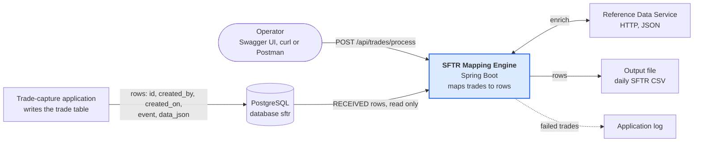

## Level 2: Containers

One Spring Boot application (`sftr-mapping-engine.jar`) with a web server on port 9090. It reads its mapping config once at startup, then handles one run at a time.

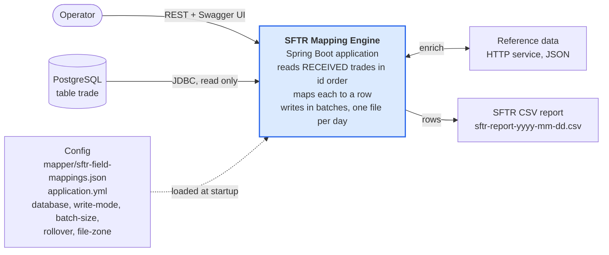

## Level 3: Components

Solid arrows run per record; dashed arrows run at startup, on the timer, or by configuration.

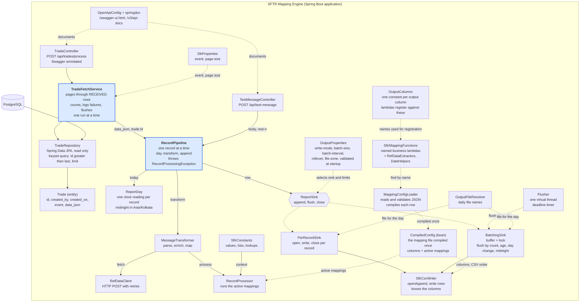

## Level 4: Code

### Config compilation (startup)

At startup `MappingConfigLoader.load()` turns every `FieldMapping` into a `Column`, and every active one also into a `CompiledMapping` that wraps a `MappingFunction`. `MappingConfiguration` exposes the result as one `CompiledConfig` bean. `RecordProcessor` takes the active mappings from it and, for each record, creates an `SftrTransactionReport` and fills it by running the compiled mappings. `SftrCsvWriter` takes the `Column` list from the same bean, so the sinks never need the rules engine; `Column.read` pulls the values back out when the CSV row is written.

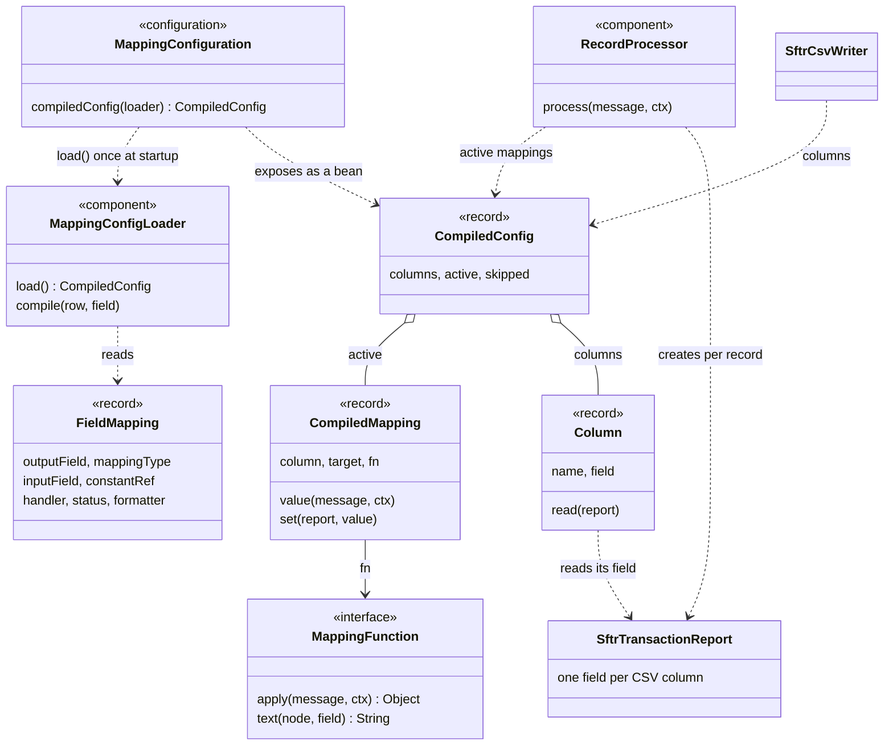

### Database input

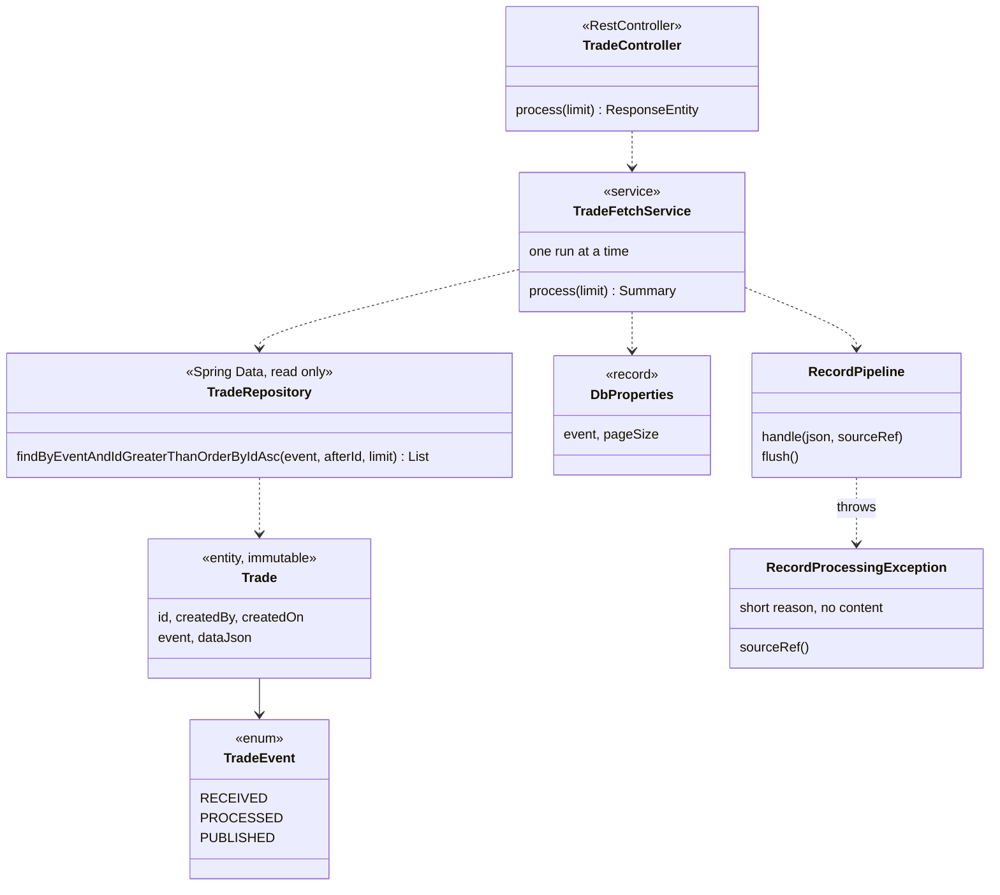

### Output

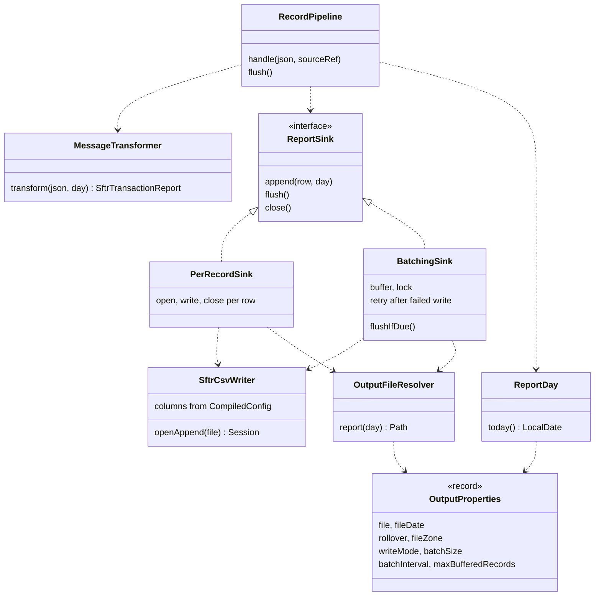

### REST endpoints and column names

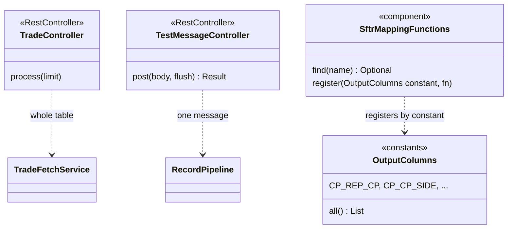

## Dynamic view 1: a table run in `COUNT` mode

Batch size 3 for the picture (the default is 100). Rows 1 to 3 fill the batch and are written together. Rows 4 and 5 fail and are logged. The final flush finds nothing waiting.

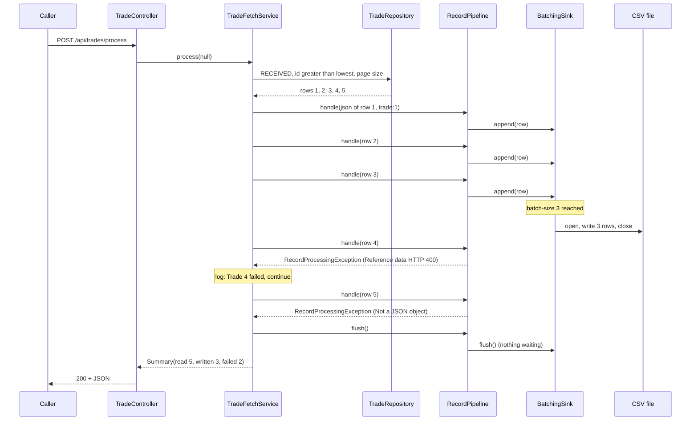

## Dynamic view 2: `PER_RECORD`, one record

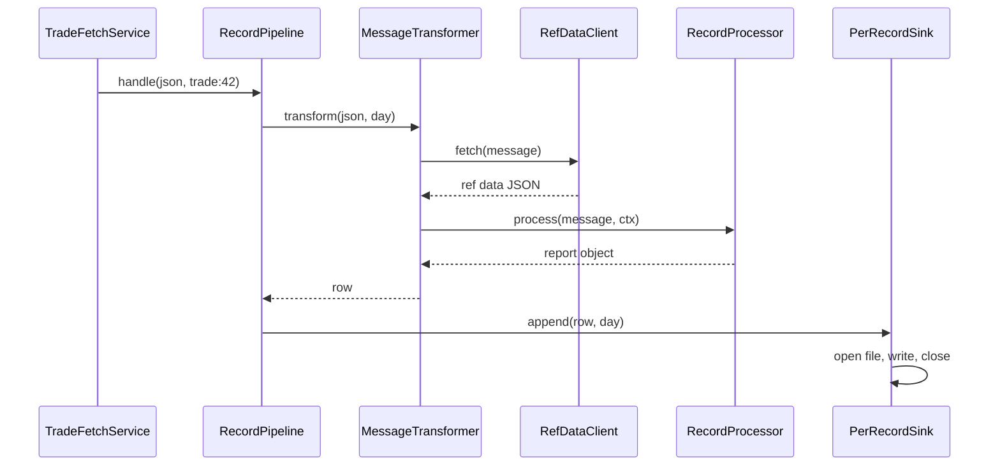

## Dynamic view 3: paging through the table

Page size 2, `RECEIVED` rows with ids 1, 3, 4, 6, 9. The other application inserts id 10 while the run is busy with the second page, so the third query already sees it.

```mermaid
sequenceDiagram
    participant S as TradeFetchService
    participant R as TradeRepository
    participant DB as trade table

    S->>R: after = lowest id, limit 2
    R->>DB: event = RECEIVED and id greater than after, order by id, limit 2
    DB-->>S: ids 1, 3
    Note over S: process 1, 3; after = 3
    S->>R: after = 3, limit 2
    DB-->>S: ids 4, 6
    Note over S: process 4, 6; after = 6
    S->>R: after = 6, limit 2
    DB-->>S: id 9 (and 10, inserted meanwhile)
    Note over S: a full page of two: process 9, 10; after = 10
    S->>R: after = 10, limit 2
    DB-->>S: no rows
    Note over S: empty page: end of the run, flush
```

## Dynamic view 4: `INTERVAL` mode

The timer thread writes the CSV when the oldest waiting row is old enough, even if no more rows arrive. In a table run the end-of-run flush usually writes the batch first.

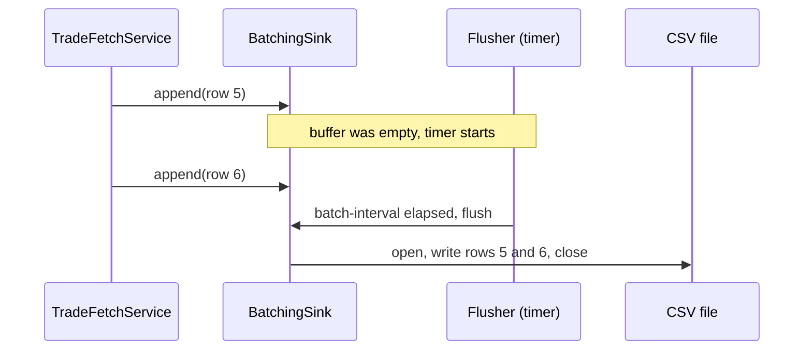

## Decision view: when does a write happen?

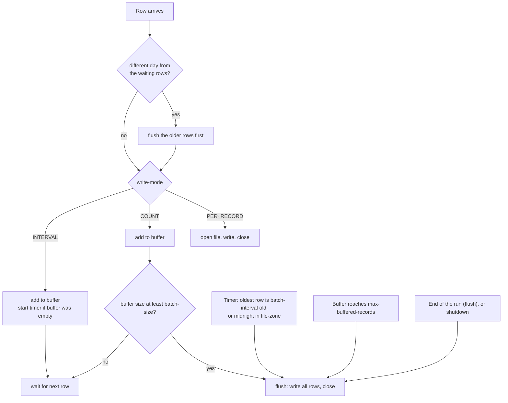

## Decision view: what happens to one row of the table?

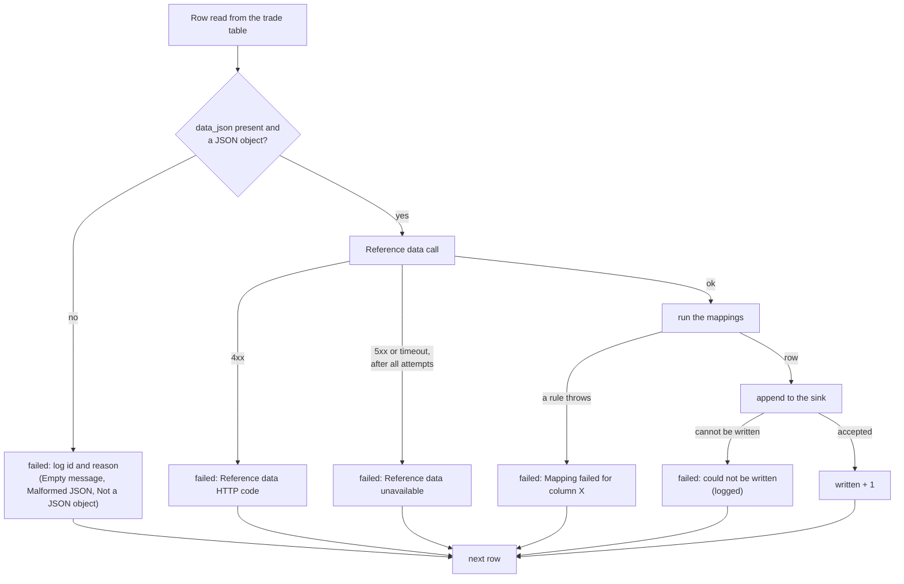
