# SFTR Mapping Engine: C4 Architecture Diagrams

Diagrams are Mermaid, so they render on GitHub and in most IDEs. See [code-flow-and-classes.md](code-flow-and-classes.md) for the written walkthrough and [design-camel-batch-writer.md](design-camel-batch-writer.md) for why it is built this way.

## Level 1: System context

The engine takes messages from Kafka or an input file, asks the Reference Data Service to enrich each one, and writes the SFTR CSV plus a rejects file for each day. It commits Kafka offsets only after the rows are on disk. One source is used per run; Kafka is the default and the `file` profile switches it off. A separate `publisher` mode of the same application sends generated messages to Kafka for testing.

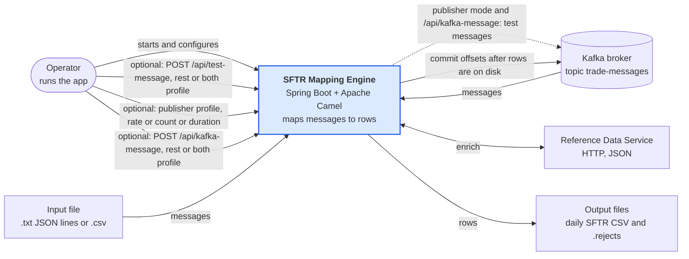

## Level 2: Containers

One Spring Boot application (`sftr-mapping-engine.jar`) with one Camel Kafka consumer, defined in a YAML route. It reads its mapping config once at startup, then handles messages one at a time. The same jar can run as a message publisher (`publisher` profile).

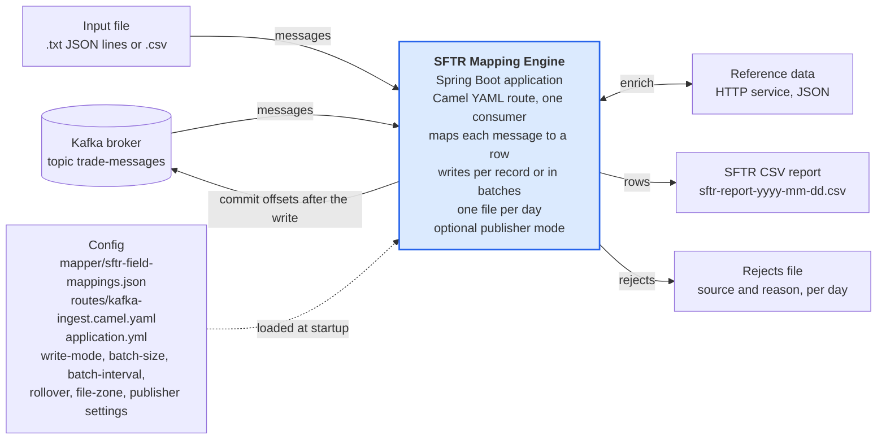

## Level 3: Components

Solid arrows run per message; dashed arrows run at startup, on the timer, or by configuration.

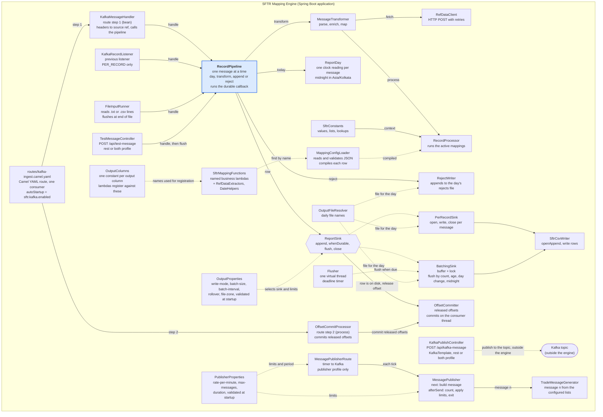

## Level 4: Code

### Config compilation (startup)

At startup `MappingConfigLoader.load()` turns every `FieldMapping` into a `Column`, and every active one also into a `CompiledMapping` that wraps a `MappingFunction`. `RecordProcessor` keeps the resulting `CompiledConfig` and, for each message, creates an `SftrTransactionReport` and fills it by running the compiled mappings. `Column.read` pulls the values back out when the CSV row is written.

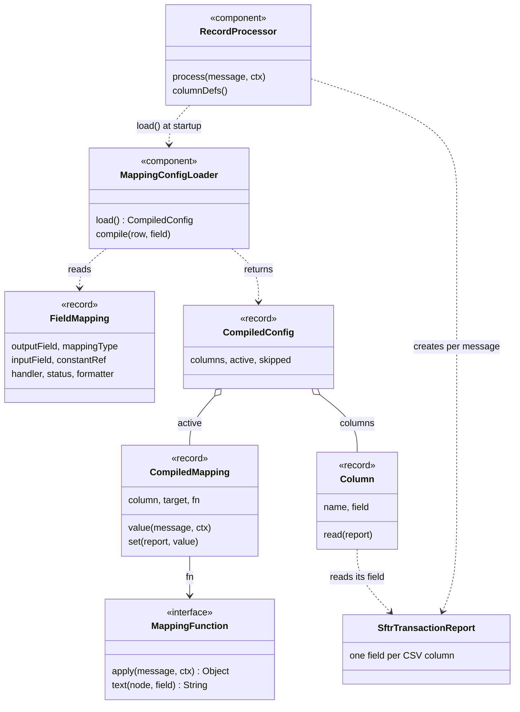

### Output (per message)

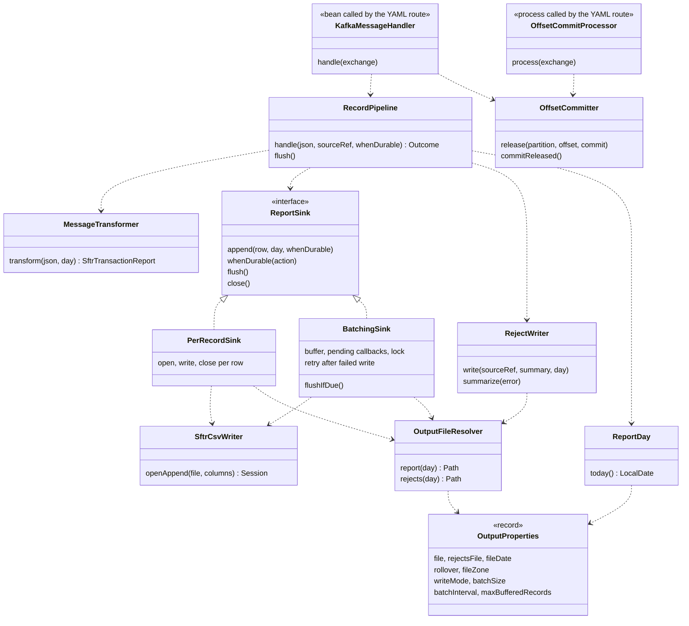

### REST endpoints

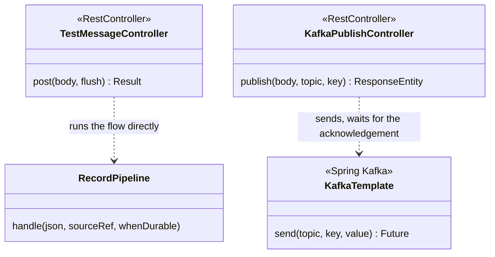

### Publisher and column names

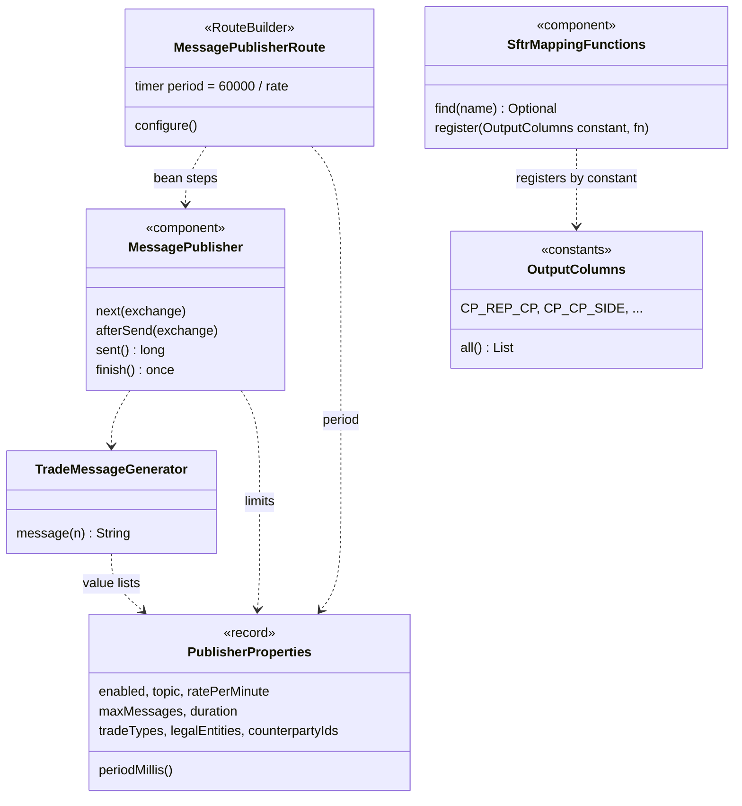

## Dynamic view 1: `PER_RECORD`, one message

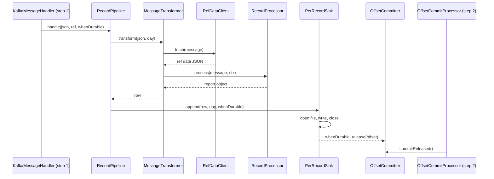

## Dynamic view 2: `COUNT` mode, batch of 3

Offsets 10 and 11 stay uncommitted while their rows wait in the buffer. The commit happens only after the write.

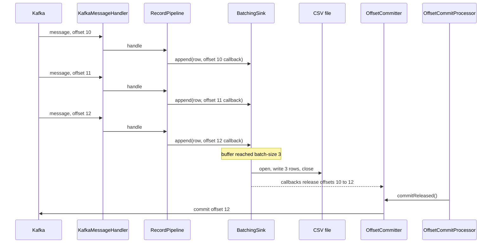

## Dynamic view 3: `INTERVAL` mode with a rejected message

The rejected message goes to the rejects file at once, but its offset waits for the batch so earlier buffered rows are not lost on a crash. The timer thread writes the CSV; the commit runs on the consumer thread when the next message arrives.

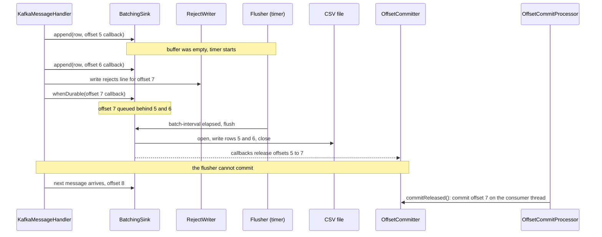

## Dynamic view 4: publisher run

`rate-per-minute: 60`, `max-messages: 3`. Each tick is one pass through the route. The third message reaches the count, so the run finishes and the application exits.

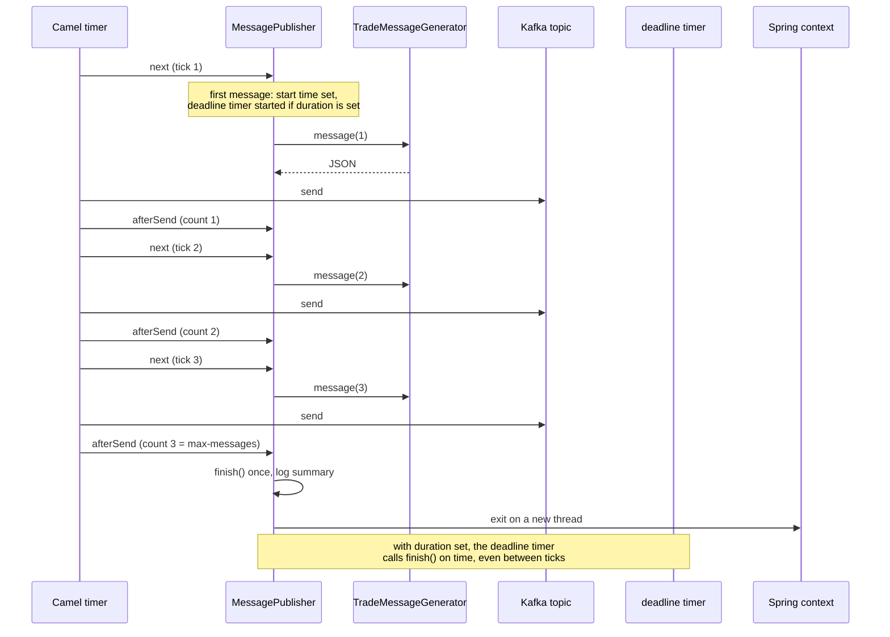

## Dynamic view 5: REST to Kafka to CSV (`both` mode)

`POST /api/kafka-message` only puts the message on the topic. The consumer then handles it exactly like a message from any producer.

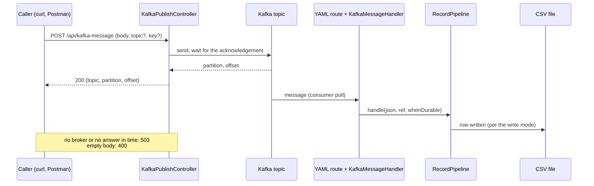

## Dynamic view 6: how the Kafka route starts

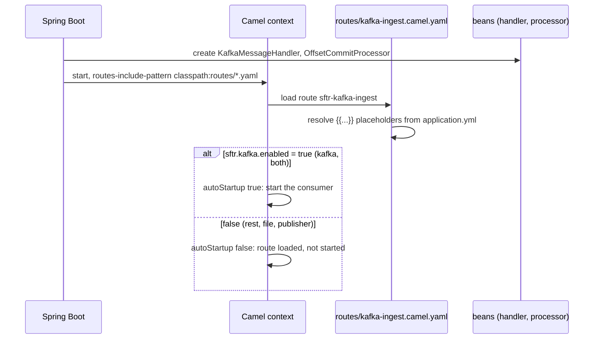

## Decision view: when does a write happen?

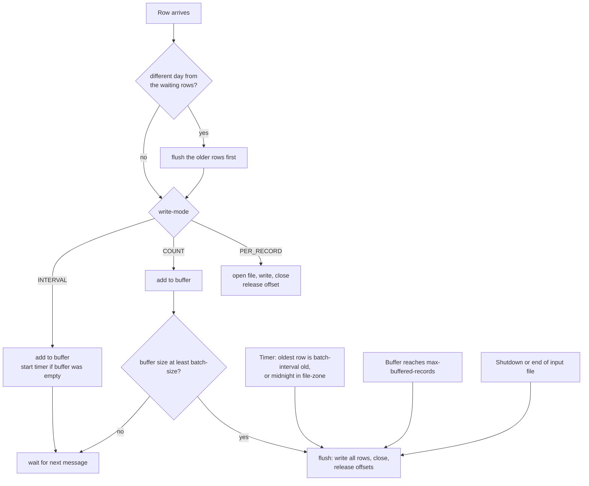

## Decision view: when does the publisher stop?

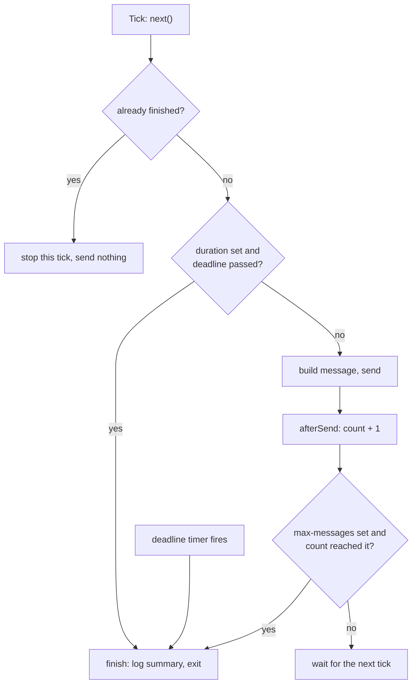
