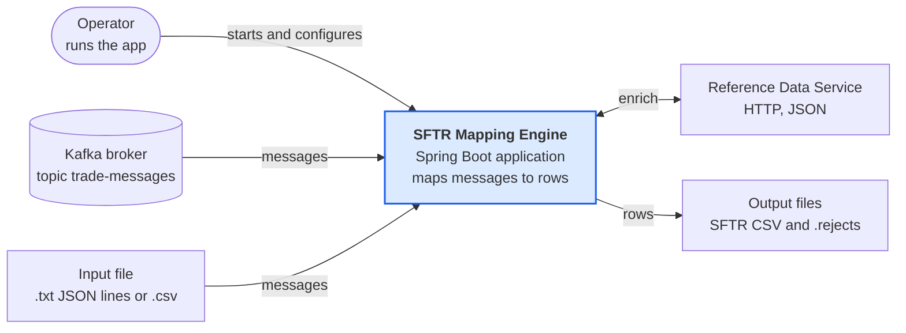
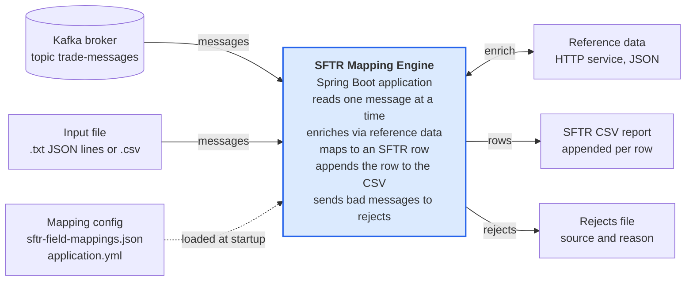
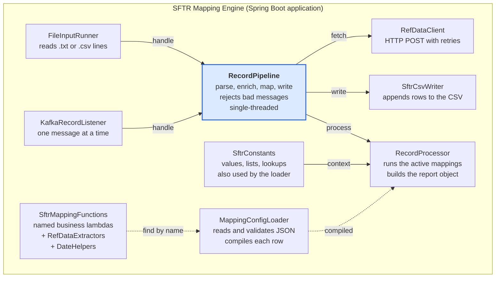
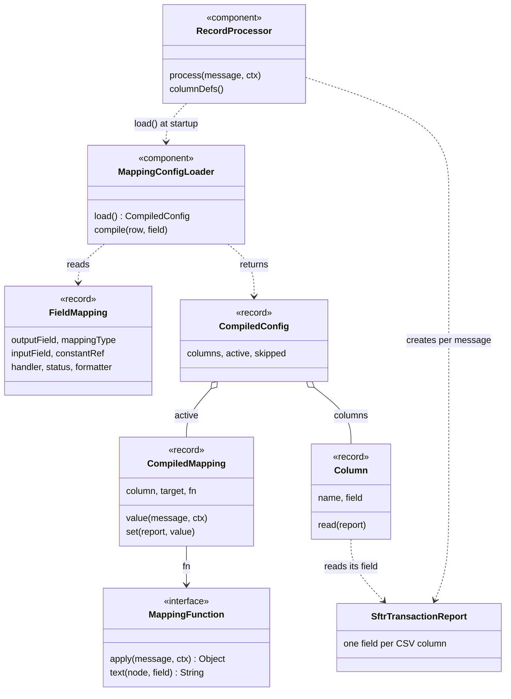
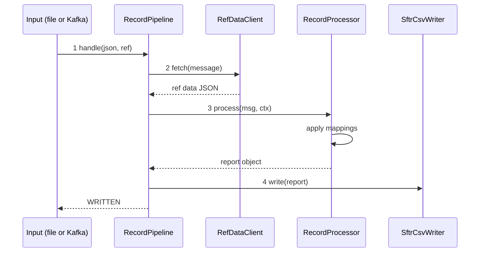

# SFTR Mapping Engine: C4 Architecture Diagrams

Diagrams are Mermaid, so they render on GitHub and in most IDEs. See [code-flow-and-classes.md](code-flow-and-classes.md) for the written walkthrough.

## Level 1: System context

The engine takes messages from Kafka or an input file, asks the Reference Data Service to enrich each one, and writes the SFTR CSV plus a rejects file. One source is used per run; Kafka is the default and the `file` profile switches it off.

## Level 2: Containers

The engine is one Spring Boot application (`sftr-mapping-engine.jar`). It reads its mapping config once at startup, then handles messages sequentially.

## Level 3: Components

Either input component hands a message to `RecordPipeline`. The pipeline calls `RefDataClient`, then `RecordProcessor`, then `SftrCsvWriter`, and writes the rejects file itself. `RecordProcessor` gets its compiled mappings from `MappingConfigLoader` once at startup, which looks lambdas up in `SftrMappingFunctions`. Solid arrows run per message; dashed arrows run at startup only.

## Level 4: Code

At startup `MappingConfigLoader.load()` turns every `FieldMapping` into a `Column`, and every active one also into a `CompiledMapping` that wraps a `MappingFunction`. `RecordProcessor` keeps the resulting `CompiledConfig` and, for each message, creates an `SftrTransactionReport` and fills it by running the compiled mappings. `Column.read` pulls the values back out when the CSV row is written.

### Dynamic view: one message

The numbered calls are the happy path. Dashed arrows are returns. If parsing, enrichment or mapping throws, the pipeline writes a rejects line and returns `REJECTED`.

