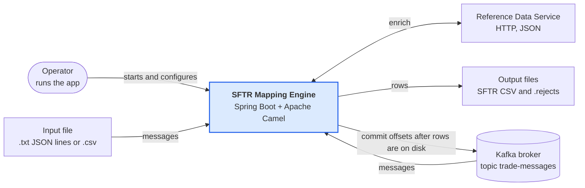
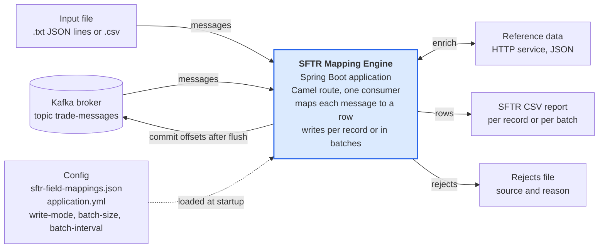
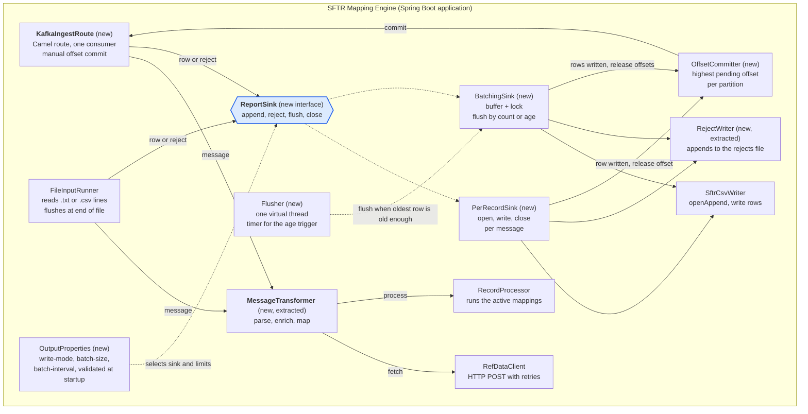
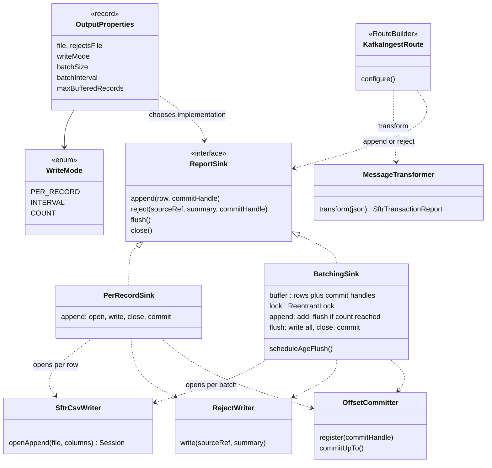
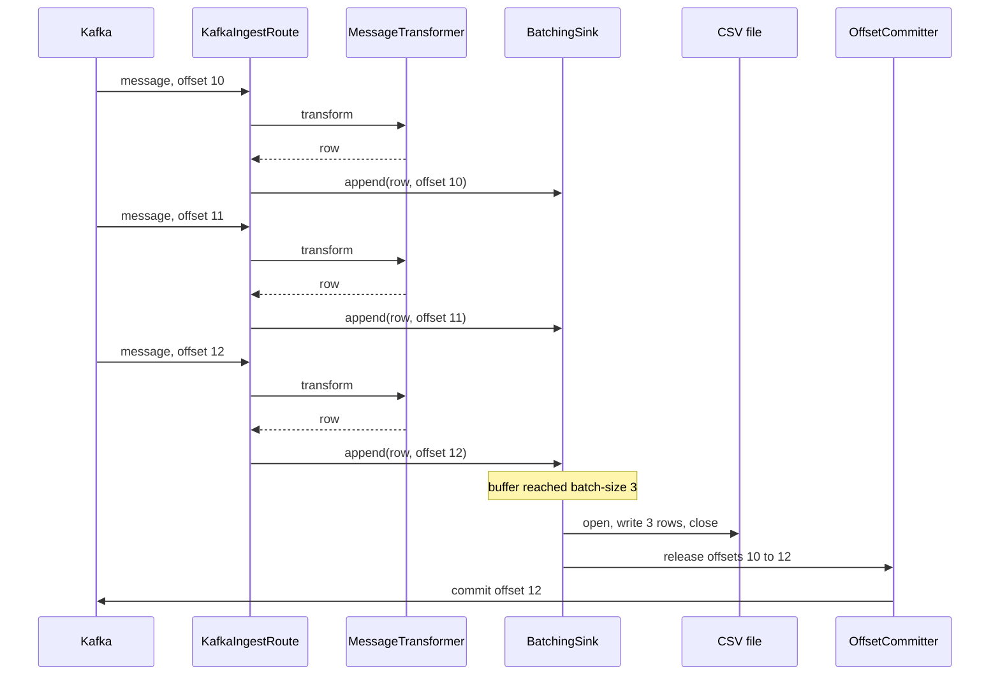
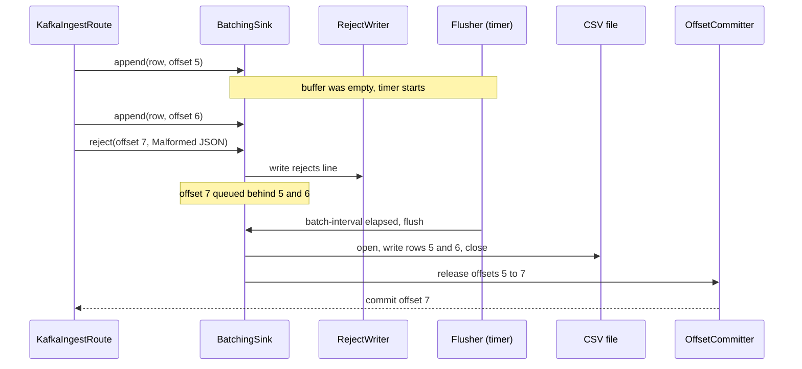
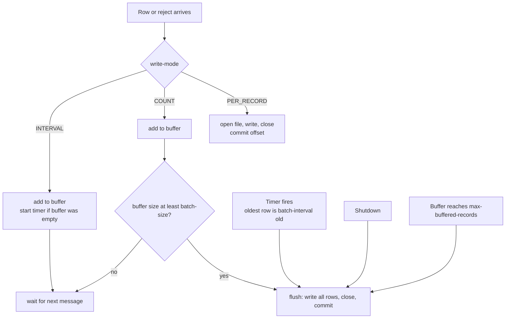

# C4 Diagrams: Camel route and configurable CSV write modes

Target design for branch `camel-batch-writer`. Written design: [design-camel-batch-writer.md](design-camel-batch-writer.md). Diagrams are Mermaid.

## Level 1: System context

Unchanged from today: the same neighbours. Only the way the engine receives Kafka messages and writes the CSV changes inside it.

## Level 2: Containers

Still one application. Two things are new inside it: the Camel runtime that consumes Kafka, and a write mode setting that decides when rows are written. The new arrow back to Kafka is the offset commit, which now waits until the CSV write.

## Level 3: Components

New components are marked **new**. `RecordPipeline` is split: `MessageTransformer` does the mapping work and `ReportSink` decides when rows are written. Solid arrows run per message; dashed arrows run at startup or on the timer.

## Level 4: Code

The sink hierarchy and the objects that carry a row together with the Kafka offset it came from.

## Dynamic view 1: `COUNT` mode, batch of 3

Offsets 10 and 11 stay uncommitted while their rows wait in the buffer. The commit happens only after the write.

## Dynamic view 2: `INTERVAL` mode with a rejected message

The rejected message goes to the rejects file at once, but its offset waits for the next flush so earlier buffered rows are not lost on a crash.

## Decision view: when does a write happen?

