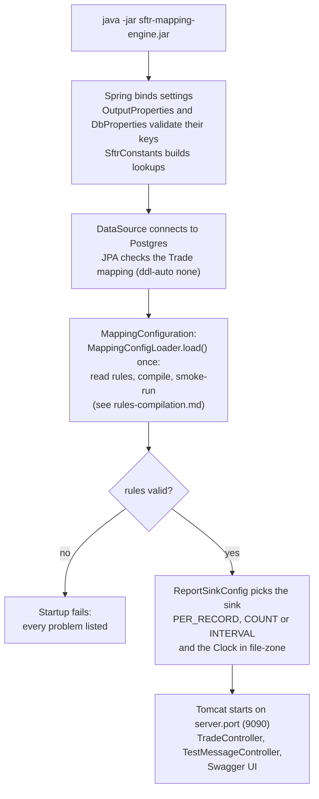
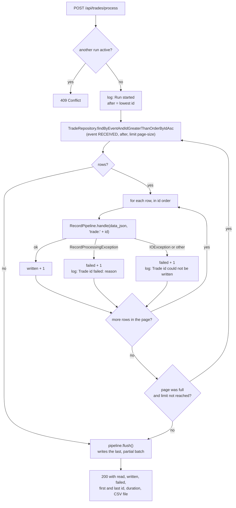
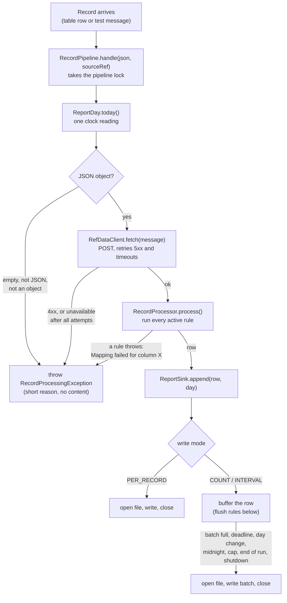

# SFTR Mapping Engine: Code Flow and Class Guide

Read [design-and-architecture.md](design-and-architecture.md) first for the purpose, principles and decisions. This document follows the code: what runs at startup, what runs for a run over the table, what runs for each record, and every class. Related: [rules-compilation.md](rules-compilation.md) (how a JSON rule becomes code, in depth), [c4-architecture.md](c4-architecture.md) (C4 diagrams).

## Overview

The app turns the trades in a database table (JSON) into rows of an SFTR CSV report, and every output column is defined by one line of JSON config. It runs in two phases:

1. **Startup (once):** `MappingConfigLoader` reads `mapper/sftr-field-mappings.json` and compiles each line into a small function. `MappingConfiguration` exposes the result as one `CompiledConfig` bean; `RecordProcessor` takes the active mappings from it and `SftrCsvWriter` takes the column list.
2. **A run (each `POST /api/trades/process`):** `TradeFetchService` reads the `RECEIVED` rows of the `trade` table in id order and hands each row's `data_json` to `RecordPipeline`. The pipeline turns it into a row with `MessageTransformer`, and a `ReportSink` decides when the row is written to that day's CSV file.

A bad record never stops the run. It is logged with its id and a short reason, and processing continues with the next row. There is no rejects file.

## Startup flow

Everything that can be wrong is checked here, before the first request.



## A run over the table

`POST /api/trades/process[?limit=n]` calls `TradeFetchService.process(limit)` on the request thread and answers when it has finished.



- The paging is a **keyset** walk: each query asks for rows with `id` greater than the last one seen, ordered by id, limited to `sftr.db.page-size`. It stays correct while the other application inserts, and it never loads the whole table.
- Each query is its own short read-only transaction. No transaction stays open while the reference-data service is called.
- The run counts `read` (rows fetched), `written` (rows handed to the CSV writer) and `failed`.
- `limit` stops the run after that many rows, even in the middle of a page.
- A failed flush at the end answers **500**; a bad `limit` answers **400**.

## Per-record flow

Every entry point calls the same method, `RecordPipeline.handle(json, sourceRef)`: the table run (`sourceRef` is `trade:<id>`) and the test endpoint (`rest-<n>`).

1. `ReportDay.today()` reads the clock once. That date is the day of the record: it goes into the row and picks the file, so the two cannot disagree around midnight.
2. `MessageTransformer.transform(json, day)` parses the JSON, calls `RefDataClient.fetch` (POST to the reference-data service, retrying 5xx and timeouts, never 4xx) and runs `RecordProcessor.process`. It returns a row or throws.
3. A failure becomes a `RecordProcessingException` whose message is a short reason that never contains the record content, because the data is regulatory. The caller logs it and moves on.
4. On success `ReportSink.append(row, day)` hands the row to the sink.



## Write modes (`sftr.output.write-mode`)

`ReportSinkConfig` creates the sink for the chosen mode. `OutputProperties` validates the settings at startup and names the bad key.

| Mode | Sink | When rows reach the CSV |
| --- | --- | --- |
| `PER_RECORD` | `PerRecordSink` | Open the file, append the row, close the file, for every record. |
| `COUNT` (default, batch of 100) | `BatchingSink` | Rows wait in a list and are written as one batch when `batch-size` rows are waiting. |
| `INTERVAL` | `BatchingSink` | Rows wait and are written as one batch when the oldest waiting row is `batch-interval` old. A flusher virtual thread watches the deadline. |

The run calls `pipeline.flush()` at the end, so the last, partial batch is written before the REST call returns.

`BatchingSink` also writes the batch when:

- the next row belongs to a different day (a batch never mixes two days);
- midnight passes in `file-zone` (rows from late evening do not wait into the next day);
- `max-buffered-records` is reached, or the sink is closed.

If a batch cannot be written, the rows stay in the list and the write is retried after 5 seconds. If the list is full and cannot be written, `append` throws and the new row is not accepted (the run counts it as failed). One lock guards the list and the file, so the request thread and the flusher never write at the same time.

## Daily files

With `sftr.output.rollover: DAILY` (default), `OutputFileResolver` adds the date before the extension: `sftr-report.csv` becomes `sftr-report-2026-10-16.csv`. A new day starts when the first row of that day arrives, so quiet days leave no empty files, and each new file gets its own header. The day changes at midnight in `sftr.output.file-zone` (default `Asia/Kolkata`). `sftr.output.file-date` pins the date used in the rows and the file names, which is useful for replays. `rollover: NONE` keeps one file with the configured name. A second run on the same day appends to that day's file.

## The database input

| Class | What it does |
| --- | --- |
| `Trade` | JPA entity for the `trade` table: `id`, `created_by`, `created_on`, `event`, `data_json`. `@Immutable`: it is only ever read. `id` is generated by the database (identity), so rows can be inserted without an id. `data_json` is a `String` (`@JdbcTypeCode(SqlTypes.JSON)`, so it works with a `jsonb` column). |
| `TradeEvent` | `RECEIVED`, `PROCESSED`, `PUBLISHED`. |
| `TradeRepository` | Spring Data repository (read only). One query: the next rows of an event after an id, ordered by id, with a `Limit`. |
| `DbProperties` | `sftr.db.event` (default `RECEIVED`) and `sftr.db.page-size` (default 500), validated at start. |
| `TradeSeeder`, `SeedProperties` | Local development only. With `sftr.db.seed.enabled=true` (the `seed` profile) the seeder inserts `sftr.db.seed.count` (10) sample `RECEIVED` trades at start-up, but only when the trade table has no rows at all. The profile also sets `ddl-auto: update`, so a missing table is created from the `Trade` entity. |

`TradeFetchService` (the loop above, the counters, the failure logging, the single-run guard and the final flush) is in the `service` package next to `RecordPipeline`: the `db` package holds the persistence classes, `service` the orchestration.

Column names are fixed in `Trade.java` (`@Column(name = ...)`); change them there if the real table differs. The local table and sample rows are created by `samples/db/02-trade-table.sql`.

## Quick test endpoint

`POST /api/test-message` runs one message through the same `RecordPipeline`, without the database:

```
curl -X POST localhost:9090/api/test-message -H "Content-Type: application/json" -d '{"trade_ref":"1","trade_type":"PO","bmoLegalEntity":"LDNBB01","counterpartyId":"CP1","group_cd":"G1"}'
```

The answer is JSON: `outcome` (`WRITTEN` or `FAILED`, both HTTP 200), `flushed`, `reportFile` (today's CSV) and `reason` (only when `FAILED`). With `flush=true` (default) a row waiting in a batch is written at once, so it is in the CSV when the call returns; use `?flush=false` to see the batch modes behave as in a real run. `RecordPipeline` serialises its calls with a lock, so this endpoint can run next to a table run.

## How the JSON config becomes running logic

`MappingConfigLoader.load()` runs once at startup and reads `mapper/sftr-field-mappings.json` into `FieldMapping` records, one per CSV column. Each row produces:

- a `Column` (name + the Java field on `SftrTransactionReport`) for **every** row. This fixes the CSV header and column order.
- a `CompiledMapping` (target field + a `MappingFunction`) only for **active** rows, meaning `status = MAPPED` and `mappingType` is not `NOT_APPLICABLE`. `PENDING` and `IGNORE` rows keep their column but stay blank.

`MappingFunction` is the core abstraction: `Object apply(JsonNode message, ProcessingContext ctx)`. Every config row is compiled into one of these in `compile()`:

| mappingType | Function it becomes |
| --- | --- |
| `DIRECT` | Copies `inputField` from the message as text. |
| `HARDCODE` | Returns a constant (`constantRef`), looked up once at startup. |
| `DIRECT_DATA_TRANSFORM` | Copies `inputField` and converts it to a number or date using `formatter` and the format/zone refs. Blank input gives null. |
| `TRANSFORM` / `ENRICH` / `LOGIC` | Looks up a hand-written lambda in `SftrMappingFunctions` by `handler` (or by `outputField` if no handler is given). |
| `NOT_APPLICABLE` | Skipped. |

**Startup validation.** The app fails to start, listing every problem at once, if a row has no `outputField` or `mappingType`, has a duplicate `outputField`, or names a field that does not exist on `SftrTransactionReport`. The same happens when no lambda is registered for a handler, or a function asks for a constant that does not exist (checked by `smokeRun`, which runs each function once against an empty message).

**Name rule.** `outputField` maps to a Java property by `propertyName()`: the text before the first `_` is lower-cased and the underscores are removed. `CP_RepCp` becomes `cpRepCp`, and `IM_SubmitterID` becomes `imSubmitterID`.

**Per record.** `RecordProcessor.process()` is a plain loop: create an `SftrTransactionReport`, then for each active mapping set `field = fn.apply(message, ctx)`. A failure is wrapped as `Mapping failed for column <name>`. `CompiledMapping.set()` converts the value to the field type through Spring's `ConversionService` if needed.

## Classes by package

All classes are under `com.bmo.sftr.mapping`.

| Package / class | Role |
| --- | --- |
| `SftrMappingApplication` | Spring Boot entry point. Registers `SftrConstants`, `RefDataClient.Properties`, `OutputProperties` and `DbProperties` as configuration properties. |
| `db.Trade`, `db.TradeEvent`, `db.TradeRepository`, `db.DbProperties`, `db.TradeSeeder`, `db.SeedProperties` | The persistence side of the database input (see above). |
| `service.TradeFetchService` | The run over the table (see above). |
| `rest.TradeController` | `POST /api/trades/process[?limit=]`: starts a run and answers with the summary (200), 409 (a run is active), 400 (bad limit) or 500 (database or CSV failure). |
| `rest.TestMessageController` | `POST /api/test-message` for quick tests of one message. |
| `rest.OpenApiConfig` | Title and description for the OpenAPI document (springdoc). Swagger UI is at `/swagger-ui.html`, the document at `/v3/api-docs`. |
| `service.RecordPipeline` | Coordinates one record: take the day, transform, append to the sink. Throws `RecordProcessingException` for a record that cannot be processed. Single-threaded by design (a lock). |
| `service.RecordProcessingException` | A record could not be turned into a row. The message is a short reason without record content; `sourceRef()` says which record. |
| `service.MessageTransformer` | Parse, reference-data fetch, run the mappings. Returns a row or throws. |
| `engine.MappingConfigLoader` | Startup: reads and validates the JSON config, compiles rows into `Column` and `CompiledMapping`. |
| `engine.MappingConfiguration` | Compiles the mapping file once and exposes the result as the `CompiledConfig` bean (columns, active mappings, skipped count). Logs the column counts. |
| `engine.RecordProcessor` | Takes the active mappings from `CompiledConfig` and runs them for each record. It does not know the CSV columns. |
| `functions.SftrMappingFunctions` | Registry of named business-logic lambdas, registered by `OutputColumns` constant, for example `CP_CpSide` and `CP_BranchOfRepCp`. |
| `functions.RefDataExtractors` | Reads values from the ref-data response by dotted path, for example `find_sftr_party.values.lei`. |
| `functions.DateHelpers` | Date parsing and formatting helpers, including the flexible ISO parser. |
| `model.FieldMapping` | One config row (record) with the enums `MappingType`, `Status` and `DataFormatter`. |
| `model.MappingFunction` | The functional interface every mapping compiles to, plus a null-safe `text()` helper. |
| `model.OutputColumns` | One constant per output column name; a test checks it against the mapping file. |
| `model.ProcessingContext` | Per-record bundle: `refData`, `constants`, `fileDate`. |
| `model.SftrConstants` | Constants from `application.yml`: single values, lists and lookup tables (for example `cpSide`). |
| `model.SftrTransactionReport` | One output row: a plain object with one field per CSV column. |
| `refdata.RefDataClient` | HTTP POST to the reference-data service with retries (5xx and timeouts only) and timeouts from config. |
| `output.OutputProperties` | Typed `sftr.output` settings with startup validation: file, file date, rollover, zone, write mode, batch size, batch interval, buffer cap. |
| `output.ReportDay` | The date of a record: the clock in `file-zone`, or the pinned `file-date`. |
| `output.OutputFileResolver` | Maps a date to the report file path. |
| `output.ReportSink` / `ReportSinkConfig` | The sink interface (`append`, `flush`, `close`; `whenDurable` is left over from the Kafka version and unused) and the bean that picks the implementation from `write-mode`. A `Clock` bean in `file-zone` is defined here too. |
| `output.PerRecordSink` | Open, append, close per row. |
| `output.BatchingSink` | Buffer, lock, count and timer triggers, day and midnight flush, retry after a failed write, flusher virtual thread. |
| `output.SftrCsvWriter` | Holds the `Column` list from `CompiledConfig` (so the sinks need no reference to the rules engine). Opens the CSV (header from the `Column` list, only for a new or empty file), writes rows, reads each value back from the report by reflection. |

**Configuration files.** `application.yml` holds the database connection, the web port, the `sftr.db`, output, ref-data and constants settings. `mapper/sftr-field-mappings.json` is the column definitions. `application-test.yml` (test sources only) points the tests at an in-memory H2 database.

## Worked example: one table run end to end

Take the sample rows from `samples/db/02-trade-table.sql`, with `write-mode: COUNT`, `batch-size: 100`.

1. `POST /api/trades/process` reaches `TradeController`, which calls `TradeFetchService.process(null)`.
2. The repository returns the `RECEIVED` rows after the lowest id, in id order (rows 1 to 5; rows 6 and 7 are `PROCESSED` and `PUBLISHED`). The page is shorter than `page-size`, so it is the last page.
3. For row 1 (`{"trade_type":"PO","bmoLegalEntity":"LDNBB01","counterpartyId":"CP1",...}`): `RecordPipeline` takes today's date, `MessageTransformer` parses the JSON, and `RefDataClient` posts `bmoLegalEntity`, `counterpartyId`, `group_cd` and `delegated` (only those present) and gets a JSON response.
4. `RecordProcessor` loops through the active mappings:
    - `IM_SubmitterID` is a `HARDCODE`, so it gets `BMOLN9000003`.
    - `CP_CpSide` is a `TRANSFORM`. The lambda looks up `PO` in the `cpSide` table and returns `GIVE`.
    - `CP_RepCp` is an `ENRICH`. It reads the LEI from the ref-data response at `find_sftr_party.values.lei`.
    - `CP_BranchOfRepCp` is a `TRANSFORM`. `LDNBB01` starts with the London prefix `LDNBB`, so the result is `GB`.
5. `BatchingSink` keeps the row. Rows 2 and 3 are handled the same way.
6. Row 4 has `counterpartyId` `FAIL4XX`: the stub answers 400, so the pipeline throws `RecordProcessingException("Reference data HTTP 400")`. The service logs `Trade 4 failed: Reference data HTTP 400` and goes on. Row 5 is `[1, 2, 3]`: `Trade 5 failed: Not a JSON object`.
7. The page is finished, so `pipeline.flush()` writes the three waiting rows: `SftrCsvWriter` opens the day's file, writes the header and the rows, and closes it.
8. The answer is `{"event":"RECEIVED","read":5,"written":3,"failed":2,"firstId":1,"lastId":5,...}`.

## How to add or change a column

| Goal | What to change |
| --- | --- |
| Copy a field, set a constant, or convert a number/date | Edit only `mapper/sftr-field-mappings.json` (`DIRECT`, `HARDCODE`, `DIRECT_DATA_TRANSFORM`). Constants and format patterns live under `sftr.constants` in `application.yml`. |
| Custom business logic | Set `TRANSFORM`, `ENRICH` or `LOGIC` in the JSON and register a lambda with the same name (or the row's `handler`) in `SftrMappingFunctions`, using the `OutputColumns` constant. |
| A new column | Add a field to `SftrTransactionReport` named by the `propertyName()` rule, add the config row and the `OutputColumns` constant. Column order follows config order. |
| Park a column | Set `status` to `PENDING` or `IGNORE`. The column stays in the CSV, empty. |

A wrong name, a missing constant or an unregistered handler fails at startup with a list of all problems, not at the first record.

## Running the tests

`mvn test` needs no Postgres, no stub and no broker. The tests that start Spring (`GoldenFileTest`, `TradeProcessingFlowTest`) use the `test` profile, which swaps in an in-memory H2 database and creates the `trade` table from the entity. `TradeProcessingFlowTest` covers the whole path with a real database, pipeline and CSV file (the reference-data call is mocked). `TradeSeederTest` checks that start-up seeds 10 `RECEIVED` rows, that seeding again adds none, and that a run over them writes all 10.
