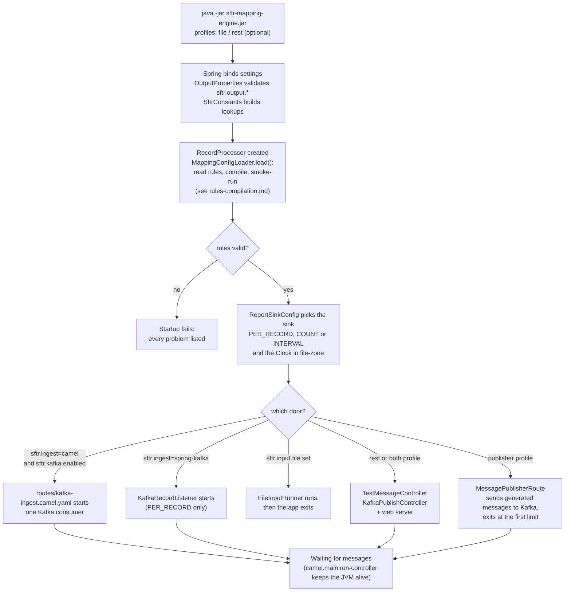
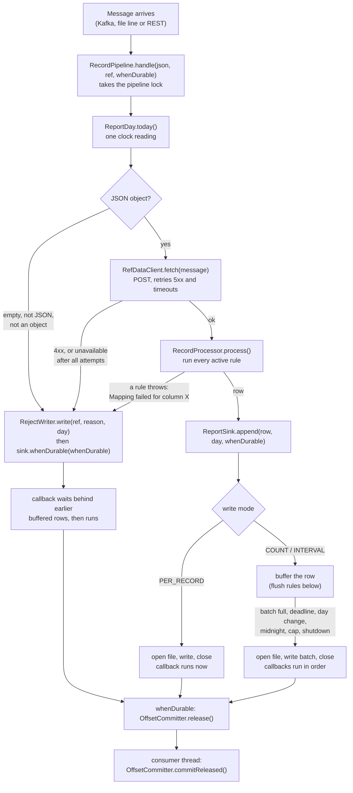

# SFTR Mapping Engine: Code Flow and Class Guide

Read [design-and-architecture.md](design-and-architecture.md) first for the purpose, principles and decisions. This document follows the code: what runs at startup, what runs for each message, and every class. Related: [rules-compilation.md](rules-compilation.md) (how a JSON rule becomes code, in depth), [c4-architecture.md](c4-architecture.md) (C4 diagrams), [design-camel-batch-writer.md](design-camel-batch-writer.md) (how the Camel route and write modes were designed).

## Overview

The app turns trade messages (JSON) into rows of an SFTR CSV report, and every output column is defined by one line of JSON config. It runs in two phases:

1. **Startup (once):** `MappingConfigLoader` reads `mapper/sftr-field-mappings.json` and compiles each line into a small function. `RecordProcessor` holds the compiled list.
2. **Per message (repeated):** an input source (Kafka through a Camel route, or a file) hands a message to `RecordPipeline`. The pipeline turns it into a row with `MessageTransformer`, and a `ReportSink` decides when the row is written to that day's CSV file.

A bad message never stops the run. It goes to that day's `.rejects` file and processing continues with the next one.

## Startup flow

Everything that can be wrong is checked here, before the first message.



## Per-message flow

Both input components call the same method, `RecordPipeline.handle(json, sourceRef, whenDurable)`.

- The Kafka route (default, `sftr.ingest: camel`) is defined in YAML, `src/main/resources/routes/kafka-ingest.camel.yaml`, and loaded through `camel.main.routes-include-pattern: classpath:routes/*.yaml`. It has one Kafka consumer (`consumersCount=1`, `maxPollRecords=1`, manual commit) and two steps: `bean: kafkaMessageHandler.handle` hands the message to `RecordPipeline`, then `process: offsetCommitProcessor` commits the offsets that `OffsetCommitter` holds (see "Offsets" below). Topic, brokers, group and offset reset come from `application.yml` through `{{...}}` placeholders. The route is loaded in every mode but has `autoStartup: "{{sftr.kafka.enabled}}"`, so it only starts in `kafka` and `both`. With `sftr.ingest=spring-kafka` also pass `--camel.main.routes-include-pattern=classpath:routes/none` so the two consumers do not both run.
- `KafkaRecordListener` (`sftr.ingest: spring-kafka`) is the previous Spring Kafka listener. It acknowledges right after handling, so it only starts with `write-mode: PER_RECORD`.
- `FileInputRunner` runs only when `sftr.input.file` is set. A `.txt` file is read as one JSON message per line (blank lines skipped). A `.csv` file uses its header row as keys, and each row becomes a flat JSON object. It counts rows written vs. rejected, never stops on a bad line, and calls `pipeline.flush()` at the end so batch modes write the last rows.
- `TestMessageController` (`POST /api/test-message`) is a quick-test door, present only with the `rest` or `both` profile (`sftr.rest.enabled: true`). See "Quick test endpoint" below.
- Which doors are on is chosen by profile, see "Run modes" below. Both Kafka components are off when `sftr.kafka.enabled: false` (the `rest` and `file` profiles).
- The app is kept alive by `camel.main.run-controller`, which follows `sftr.kafka.enabled`: Camel's Kafka consumer threads are daemon threads, so without it the JVM exits right after startup (found in a smoke run). In file mode it is false, so the app exits when the file is done.

Inside `RecordPipeline.handle()`:

1. `ReportDay.today()` reads the clock once. That date is the day of the message: it goes into the row and picks the file, so the two cannot disagree around midnight.
2. `MessageTransformer.transform(json, day)` parses the JSON, calls `RefDataClient.fetch` (POST to the reference-data service, retrying 5xx and timeouts, never 4xx) and runs `RecordProcessor.process`. It returns a row or throws.
3. On success, `ReportSink.append(row, day, whenDurable)` hands the row to the sink.
4. On failure, `RejectWriter.write(sourceRef, summary, day)` appends `sourceRef<TAB>summary` to the day's rejects file, then `sink.whenDurable(whenDurable)`. The summary never contains message content, because the data is regulatory.

`whenDurable` is a callback that runs once the message's outcome is on disk: its row is in the CSV, or its reject line is written and every earlier row is in the CSV too.

The whole path, with every branch:



## Write modes (`sftr.output.write-mode`)

`ReportSinkConfig` creates the sink for the chosen mode. `OutputProperties` validates the settings at startup and names the bad key.

| Mode | Sink | When rows reach the CSV |
| --- | --- | --- |
| `PER_RECORD` (default) | `PerRecordSink` | Open the file, append the row, close the file, for every message. |
| `COUNT` | `BatchingSink` | Rows wait in a list and are written as one batch when `batch-size` rows are waiting. |
| `INTERVAL` | `BatchingSink` | Rows wait and are written as one batch when the oldest waiting row is `batch-interval` old. A flusher virtual thread watches the deadline, so rows are written even when no more messages arrive. |

`BatchingSink` also writes the batch when:

- the next row belongs to a different day (a batch never mixes two days);
- midnight passes in `file-zone` (rows from late evening do not wait into the next day);
- `max-buffered-records` is reached, or the sink is closed.

If a batch cannot be written, the rows stay in the list and the write is retried after 5 seconds. If the list is full and cannot be written, `append` throws and the new row is not accepted. One lock guards the list and the file, so the consumer thread and the flusher never write at the same time.

## Daily files

With `sftr.output.rollover: DAILY` (default), `OutputFileResolver` adds the date before the extension: `sftr-report.csv` becomes `sftr-report-2026-10-16.csv`, and the default rejects file is `sftr-report-2026-10-16.csv.rejects`. A new day starts when the first row of that day arrives, so quiet days leave no empty files, and each new file gets its own header. The day changes at midnight in `sftr.output.file-zone` (default `Asia/Kolkata`). `sftr.output.file-date` pins the date used in the rows and the file names, which is useful for replays. `rollover: NONE` keeps one file with the configured name.

## Offsets (Kafka with the Camel route)

An offset is committed only after everything up to it is on disk, so with batching a crash never loses rows that were only in memory.

1. `KafkaMessageHandler` (the `bean` step) gives `RecordPipeline` a callback that calls `OffsetCommitter.release(partition, offset, commit)`.
2. The sink runs the callback after the row is written: right away in `PER_RECORD`, after the batch in `COUNT` and `INTERVAL`. A rejected message's callback waits behind the rows before it.
3. Only the Kafka consumer thread may commit (committing from another thread throws `ConcurrentModificationException`). So the second route step, `OffsetCommitProcessor`, calls `OffsetCommitter.commitReleased()` after every message. A batch written by the consumer thread (`COUNT`, or a day change) is committed at once. A batch written by the flusher thread (`INTERVAL`) is committed when the next message arrives.

Delivery is at least once: after a crash or restart, messages whose rows were written but whose offset was not yet committed are read again and written twice. In `INTERVAL` mode that window lasts until the next message arrives.

## Run modes

One profile picks the mode:

| Profile | Kafka consumer | REST endpoint | Web server |
| --- | --- | --- | --- |
| `kafka` (also the default with no profile) | on | off | none |
| `rest` | off | on (`/api/test-message`, `/api/kafka-message`) | Tomcat on `server.port` (default 9090) |
| `both` | on | on | Tomcat on `server.port` |
| `file` | off | off | none; reads `sftr.input.file`, then exits |

They are the files `application-kafka.yml`, `application-rest.yml`, `application-both.yml` and `application-file.yml`, which set `sftr.kafka.enabled`, `sftr.rest.enabled` and `spring.main.web-application-type`. In `both` mode the Kafka consumer thread and a web request thread share `RecordPipeline`; its lock handles messages one at a time. Step by step instructions, a Postman collection and test cases: [running-locally.md](running-locally.md).

## Quick test endpoint

Start the app with `--spring.profiles.active=rest` (REST only) or `both` (REST and Kafka). It starts a web server on `server.port` (default 9090; use `--server.port=<port>` if that is busy).

```
curl -X POST localhost:9090/api/test-message -H "Content-Type: application/json"      -d '{"trade_ref":"1","trade_type":"PO","bmoLegalEntity":"LDNBB01","counterpartyId":"CP1","group_cd":"G1"}'
```

The message goes through the same `RecordPipeline` as Kafka and file input: reference-data call, mappings, sink. The answer is JSON: `outcome` (`WRITTEN` or `REJECTED`, both HTTP 200), `flushed`, `reportFile` (today's CSV) and `rejectsFile` (only when rejected). With `flush=true` (default) a row waiting in a batch is written at once, so it is in the CSV when the call returns; use `?flush=false` to see the batch modes behave as in production. `RecordPipeline` serialises its calls with a lock, so this endpoint can run next to the Kafka consumer.

## Sending a message to Kafka through REST

`POST /api/kafka-message` (same profiles, `rest` or `both`) is the other way round: it does **not** run the pipeline. `KafkaPublishController` hands the body to a `KafkaTemplate` and waits for the broker's acknowledgement.

```
curl -X POST "localhost:9090/api/kafka-message?topic=trade-messages&key=k1" -H "Content-Type: application/json" -d '{"trade_ref":"1","trade_type":"PO","bmoLegalEntity":"LDNBB01","counterpartyId":"CP1"}'
```

`topic` defaults to `sftr.kafka.topic`, the topic the consumer listens to; `key` is optional. The body is sent exactly as received, without parsing, so a bad message reaches the consumer and ends up in the rejects file. The answer is `{"topic","partition","offset"}` (200), 400 for an empty body, or 503 if Kafka cannot be reached within `sftr.rest.publish-timeout` (the producer itself gives up after `max.block.ms`, 5 s). The content is never logged or echoed.

In `both` mode the message then travels the normal Kafka path: Kafka topic, the YAML route, `KafkaMessageHandler`, `RecordPipeline`, the CSV. In `rest` mode there is usually no broker, so the call answers 503.

## How the JSON config becomes running logic

`MappingConfigLoader.load()` runs once at startup and reads `mapper/sftr-field-mappings.json` into `FieldMapping` records, one per CSV column. Each row produces:

- a `Column` (name + the Java field on `SftrTransactionReport`) for **every** row. This fixes the CSV header and column order.
- a `CompiledMapping` (target field + a `MappingFunction`) only for **active** rows, meaning `status = MAPPED` and `mappingType` is not `NOT_APPLICABLE`. `PENDING` and `IGNORE` rows keep their column but stay blank.

`MappingFunction` is the core abstraction: `Object apply(JsonNode message, ProcessingContext ctx)`. Every config row is compiled into one of these in `compile()`:

| mappingType | Function it becomes |
| --- | --- |
| `DIRECT` | Copies `inputField` from the message as text. |
| `HARDCODE` | Returns a constant (`constantRef`), looked up once at startup. |
| `DIRECT_DATA_TRANSFORM` | Copies `inputField` and converts it to a number or date using `formatter` and the format/zone refs. Blank input gives null. |
| `TRANSFORM` / `ENRICH` | Looks up a hand-written lambda in `SftrMappingFunctions` by `handler` (or by `outputField` if no handler is given). |
| `NOT_APPLICABLE` | Skipped. |

**Startup validation.** The app fails to start, listing every problem at once, if a row has no `outputField` or `mappingType`, has a duplicate `outputField`, or names a field that does not exist on `SftrTransactionReport`. The same happens when no lambda is registered for a handler, or a function asks for a constant that does not exist (checked by `smokeRun`, which runs each function once against an empty message).

**Name rule.** `outputField` maps to a Java property by `propertyName()`: the text before the first `_` is lower-cased and the underscores are removed. `CP_RepCp` becomes `cpRepCp`, and `IM_SubmitterID` becomes `imSubmitterID`.

**Per message.** `RecordProcessor.process()` is a plain loop: create an `SftrTransactionReport`, then for each active mapping set `field = fn.apply(message, ctx)`. A failure is wrapped as `Mapping failed for column <name>`. `CompiledMapping.set()` converts the value to the field type through Spring's `ConversionService` if needed.

## Classes by package

All classes are under `com.bmo.sftr.mapping`.

| Package / class | Role |
| --- | --- |
| `SftrMappingApplication` | Spring Boot entry point. Registers `SftrConstants`, `RefDataClient.Properties` and `OutputProperties` as configuration properties. |
| `routes/kafka-ingest.camel.yaml` | Camel YAML route (a resource, not a class): one Kafka consumer, manual offset commit. Step 1 is the bean `kafkaMessageHandler.handle`, step 2 the process `offsetCommitProcessor`. |
| `camel.KafkaMessageHandler` | The bean of step 1. Reads topic, partition and offset from the headers, calls the pipeline with a callback that releases the offset, logs and skips any failure. Stops the route before the sink closes. |
| `camel.OffsetCommitProcessor` | The process of step 2. Calls `OffsetCommitter.commitReleased()` on the consumer thread. |
| `camel.OffsetCommitter` | Holds offsets whose rows are on disk until the consumer thread commits them. Keeps the highest per partition. |
| `publisher.MessagePublisherRoute` | Timer route to Kafka, only with `sftr.publisher.enabled=true` (the `publisher` profile). The timer period is 60000 / `rate-per-minute`, which is why this route is Java and not YAML. |
| `publisher.MessagePublisher` | The two route steps. `next` sets the next message as the body; `afterSend` counts it. Ends the run at `max-messages` or `duration`, whichever comes first, then exits the application. |
| `publisher.TradeMessageGenerator` | Builds message n as JSON, taking trade type, legal entity and counterparty id in turn from the configured lists. |
| `publisher.PublisherProperties` | Typed `sftr.publisher` settings with start-up validation. |
| `rest.OpenApiConfig` | Title and description for the OpenAPI document (springdoc). Swagger UI is at `/swagger-ui.html`, the document at `/v3/api-docs`; only with the `rest` or `both` profile. |
| `rest.KafkaPublishController` | Optional `POST /api/kafka-message`: publishes the body to a Kafka topic with a `KafkaTemplate` and answers with partition and offset (`rest` or `both` profile). |
| `rest.TestMessageController` | Optional `POST /api/test-message` for quick tests (`rest` profile only). |
| `kafka.KafkaRecordListener` | Previous Spring Kafka listener, used when `sftr.ingest=spring-kafka`. `PER_RECORD` only. |
| `input.FileInputRunner` | Batch alternative to Kafka. Reads a `.txt` (JSON lines) or `.csv` file, calls the pipeline per line, flushes at the end. |
| `service.RecordPipeline` | Coordinates one message: take the day, transform, append to the sink or write a reject, run the callback. Single-threaded by design. |
| `service.MessageTransformer` | Parse, reference-data fetch, run the mappings. Returns a row or throws. |
| `engine.MappingConfigLoader` | Startup: reads and validates the JSON config, compiles rows into `Column` and `CompiledMapping`. |
| `engine.RecordProcessor` | Holds the compiled config and runs the active mappings for each message. |
| `functions.SftrMappingFunctions` | Registry of named business-logic lambdas, for example `CP_CpSide` and `CP_BranchOfRepCp`. |
| `functions.RefDataExtractors` | Reads values from the ref-data response by dotted path, for example `find_sftr_party.values.lei`. |
| `functions.DateHelpers` | Date parsing and formatting helpers, including the flexible ISO parser. |
| `model.FieldMapping` | One config row (record) with the enums `MappingType`, `Status` and `DataFormatter`. |
| `model.MappingFunction` | The functional interface every mapping compiles to, plus a null-safe `text()` helper. |
| `model.ProcessingContext` | Per-message bundle: `refData`, `constants`, `fileDate`. |
| `model.SftrConstants` | Constants from `application.yml`: single values, lists and lookup tables (for example `cpSide`). |
| `model.SftrTransactionReport` | One output row: a plain object with one field per CSV column. |
| `refdata.RefDataClient` | HTTP POST to the reference-data service with retries (5xx and timeouts only) and timeouts from config. |
| `output.OutputProperties` | Typed `sftr.output` settings with startup validation: file, rejects file, file date, rollover, zone, write mode, batch size, batch interval, buffer cap. |
| `output.ReportDay` | The date of a message: the clock in `file-zone`, or the pinned `file-date`. |
| `output.OutputFileResolver` | Maps a date to the report and rejects file paths. |
| `output.ReportSink` / `ReportSinkConfig` | The sink interface (`append`, `whenDurable`, `flush`, `close`) and the bean that picks the implementation from `write-mode`. A `Clock` bean in `file-zone` is defined here too. |
| `output.PerRecordSink` | Open, append, close per row. |
| `output.BatchingSink` | Buffer, lock, count and timer triggers, day and midnight flush, retry after a failed write, flusher virtual thread. |
| `output.RejectWriter` | Appends reject lines to the day's rejects file and builds the content-free reason. |
| `output.SftrCsvWriter` | Opens the CSV (header from the `Column` list, only for a new or empty file), writes rows, reads each value back from the report by reflection. |

**Configuration files.** `application-kafka.yml`, `application-rest.yml` and `application-both.yml` choose the run mode, and `application-publisher.yml` turns the message publisher on. `application.yml` holds the ingest choice, Kafka, output settings, ref-data settings, constants and lookups. `application-file.yml` turns Kafka off for the `file` profile. `mapper/sftr-field-mappings.json` is the column definitions, and `routes/kafka-ingest.camel.yaml` is the Kafka route.

## Worked example: one line end to end

Take the first line of `samples/input.txt`: `{"trade_type":"PO","bmoLegalEntity":"LDNBB01","counterpartyId":"CP1","group_cd":"G1"}`, run with the `file` profile and `write-mode: COUNT`, `batch-size: 3`.

1. `FileInputRunner.readLines` reads the line and calls `handle(line, "input.txt:1", ...)`.
2. `RecordPipeline` takes today's date (say 2026-10-16) and `MessageTransformer` parses the line. `RefDataClient` posts `bmoLegalEntity`, `counterpartyId`, `group_cd` and `delegated` (only those present) and gets a JSON response.
3. `RecordProcessor` loops through the active mappings:
    - `IM_SubmitterID` is a `HARDCODE`, so it gets `BMOLN9000003`.
    - `CP_CpSide` is a `TRANSFORM`. The lambda looks up `PO` in the `cpSide` table and returns `GIVE`.
    - `CP_RepCp` is an `ENRICH`. It reads the LEI from the ref-data response at `find_sftr_party.values.lei`.
    - `CP_BranchOfRepCp` is a `TRANSFORM`. `LDNBB01` starts with the London prefix `LDNBB`, so the result is `GB`.
4. `BatchingSink` keeps the row. Nothing is in `sftr-report-2026-10-16.csv` yet.
5. The third valid row completes the batch: `SftrCsvWriter` opens the day's file, writes the header and the three rows, and closes it. `FileInputRunner` also calls `flush()` at the end of the file for rows still waiting.

The line `this line is not json` in the same file fails at parsing. It is written to `sftr-report-2026-10-16.csv.rejects` as `input.txt:5<TAB>Malformed JSON`, and the run continues.

## How to add or change a column

| Goal | What to change |
| --- | --- |
| Copy a field, set a constant, or convert a number/date | Edit only `mapper/sftr-field-mappings.json` (`DIRECT`, `HARDCODE`, `DIRECT_DATA_TRANSFORM`). Constants and format patterns live under `sftr.constants` in `application.yml`. |
| Custom business logic | Set `TRANSFORM` or `ENRICH` in the JSON and register a lambda with the same name (or the row's `handler`) in `SftrMappingFunctions`. |
| A new column | Add a field to `SftrTransactionReport` named by the `propertyName()` rule, then add the config row. Column order follows config order. |
| Park a column | Set `status` to `PENDING` or `IGNORE`. The column stays in the CSV, empty. |

A wrong name, a missing constant or an unregistered handler fails at startup with a list of all problems, not at the first message.

## Running the tests

`mvn test` needs no broker. Two end-to-end tests use a real Kafka and run only with `-Dkafka.it=true` and a broker on `localhost:19092`: `CamelCountModeKafkaTest` and `CamelIntervalModeKafkaTest`.
