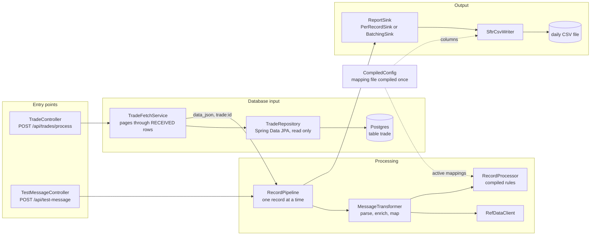

# SFTR Mapping Engine: Design and Architecture

What the system does, how it is put together, and why. For the line-by-line flow see [code-flow-and-classes.md](code-flow-and-classes.md); for the mapping rules see [rules-compilation.md](rules-compilation.md); for pictures see [c4-architecture.md](c4-architecture.md).

## 1. Purpose

Another application stores each trade as a JSON document in the `trade` table of a Postgres database. The engine turns those documents into an **SFTR transaction report**: a CSV with one column per report field and one row per trade, in a file for that day. Some columns need data from a **Reference Data Service** (for example the reporting counterparty's LEI), so the engine calls it for each trade.

A run is started by one REST call. It reads the trades whose event is `RECEIVED`, maps each to a row, and writes the CSV.

| In | Out |
| --- | --- |
| Rows of the `trade` table with event `RECEIVED` (id, created_by, created_on, event, `data_json`) | `sftr-report-yyyy-mm-dd.csv`, one row per good trade |
| Reference-data answers over HTTP | The log: one line per trade that failed (id and a short reason, never the JSON) |
| Mapping rules in JSON, constants in YAML | A summary in the REST answer: read, written, failed |

The engine only reads the table. It never updates a row, so the other application's data is untouched.

## 2. Design principles

| Principle | What it means in the code |
| --- | --- |
| **Rules are data, not code** | Each column is a JSON rule. Most columns need no Java at all. Logic that cannot be data is a named lambda. |
| **Fail at startup, not on trade one** | Rules are compiled once. Wrong names, missing constants, bad patterns and missing handlers stop the app with every problem listed. |
| **One record at a time, in order** | One run walks the table in id order on one thread, and `RecordPipeline` serialises calls with a lock. Rows appear in the order trades were read. |
| **A bad record never stops the run** | It is logged with its id and a short reason, and the next record is processed. |
| **No regulatory data in logs or reasons** | Failure reasons and conversion errors never contain trade content. `SftrTransactionReport` has no `toString`. |
| **Column names live in one place** | `OutputColumns` lists every output column name. Mapping lambdas register against those constants, never against string literals, and a test fails if the list and the mapping file differ. |
| **The sinks do not know the rules engine** | The mapping file is compiled once into the `CompiledConfig` bean; the mappings go to `RecordProcessor` and the column list goes to `SftrCsvWriter`. |

## 3. Architecture at a glance

One Spring Boot application (`sftr-mapping-engine.jar`) with a web server on port 9090.

| Layer | Classes | Responsibility |
| --- | --- | --- |
| Entry points | `TradeController`, `TestMessageController` | Start a run over the table, or push one message through the same flow. |
| Persistence (`db`) | `Trade`, `TradeEvent`, `TradeRepository`, `DbProperties`, `TradeSeeder`, `SeedProperties` | The `trade` table as an entity, the keyset query, the settings, and the local-only seeder. No business flow in this package. |
| Orchestration (`service`) | `TradeFetchService`, next to `RecordPipeline` | Read the `RECEIVED` rows in id order, a page at a time, and hand each row's JSON to the pipeline. Count, log failures, flush at the end. |
| Coordination | `RecordPipeline`, `ReportDay` | Take the day once, call the transformer, hand the row to the sink. Throws `RecordProcessingException` for a record that cannot be processed. |
| Transformation | `MessageTransformer`, `RefDataClient`, `RecordProcessor`, `MappingConfigLoader`, `MappingConfiguration` | Message to row. Rules are compiled once at startup and shared as the `CompiledConfig` bean. |
| Output | `ReportSink`, `PerRecordSink`, `BatchingSink`, `SftrCsvWriter`, `OutputFileResolver` | Decide when and where rows are written. The CSV writer knows the columns; the sinks know nothing about the rules engine. |
| Column names | `OutputColumns`, `SftrMappingFunctions` | One constant per output column; lambdas are registered by constant. |
| API documentation | `OpenApiConfig`, springdoc | Swagger UI at `/swagger-ui.html`, OpenAPI at `/v3/api-docs`. |
| Configuration | `DbProperties`, `OutputProperties`, `SftrConstants`, `RefDataClient.Properties` | Typed, validated settings. |

## 4. The two phases

1. **Startup.** Spring creates the beans and connects to the database. `MappingConfiguration` asks `MappingConfigLoader` to compile the rules once (see [rules-compilation.md](rules-compilation.md)). `OutputProperties` and `DbProperties` validate their settings. The sink is chosen from `write-mode`. If anything is wrong, the app stops here.
2. **Running.** A call to `POST /api/trades/process` runs `TradeFetchService` on the request thread. Nothing is re-read or re-compiled between runs.

## 5. Key decisions and why

| Decision | Reason | Alternative not taken |
| --- | --- | --- |
| Compile rules to functions at startup | Errors surface at deployment; no per-message parsing or reflection lookup | Interpret the JSON for every message |
| Spring Data JPA with a read-only entity | A repository was asked for; `@Immutable` and `ddl-auto: none` make clear that the table belongs to another application | Writing SQL by hand with `JdbcTemplate` |
| Keyset paging (`id > last id`, ordered by id, limited) | Constant memory, stable while the other application inserts, an index on `(event, id)` serves it | `OFFSET` paging (slower, can skip or repeat rows when data changes) or loading the whole table |
| No long transaction | Each page query is its own short read-only transaction, so a slow reference-data call never holds a database transaction open | One transaction around the whole run |
| `data_json` read as text and passed on unchanged | The pipeline already parses JSON; the entity stays simple | Mapping the JSON to a Java class |
| Synchronous run | Simple: the answer is the result. Fine for the volumes expected | An asynchronous job with a status endpoint (needed only if runs outlast HTTP timeouts) |
| Only one run at a time (409 otherwise) | The CSV sink owns the output file and rows must stay in order | Allowing parallel runs |
| One processing thread | Row order must equal read order, and the sink owns the file | A worker pool (reorders rows, needs a reorder step) |
| No rejects file; failures are logged | Requested. The log has the id, so the row can be found in the table | A rejects file as before |
| Batch writes (`COUNT`, 100) by default, flushed at the end of the run | Fewer file opens for large runs; the end-of-run flush means the CSV is complete when the call returns | Writing every row at once (`PER_RECORD`, still available) |
| Pick the day once per record | The row's date and its file cannot disagree around midnight | Read the clock separately in several places |
| New file when the first row of a day arrives | No helper thread, no empty files | A midnight timer that creates files |
| `Asia/Kolkata` day boundary, configurable | Stated requirement; `file-zone` makes it explicit | Server default zone |
| Failed batch write keeps the rows and retries | Dropping a batch silently would lose data | Log and skip |
| Output column names as constants | A typo is a compile error, and a test compares the constants with the mapping file | String literals in each lambda registration |
| Default port 9090 | 8080 is often used by other applications | 8080 |
| Seeder behind a profile, off by default, inserts only into an empty table | Gives a developer data to work with in one step, and cannot pile up rows or touch a table another application has filled | Always seeding, or seeding by SQL script only |
| `Trade.id` generated by the database | Rows can be inserted without an id and the table's own sequence keeps working for the other application | Setting ids by hand (would collide later) |

## 6. Threads

| Thread | Does | Notes |
| --- | --- | --- |
| Web request thread (Tomcat) | Runs the whole `POST /api/trades/process`: fetch, map, write, final flush | The only thread that reads the table. A second request gets 409. |
| Web request thread (test endpoint) | `POST /api/test-message` | `RecordPipeline` serialises it with a running table run. |
| `sftr-batch-flusher` (one virtual thread) | Writes a batch when its deadline passes (midnight, or the interval in `INTERVAL` mode) | Only for `COUNT` and `INTERVAL`. Started on the first buffered row. |

One `ReentrantLock` in `RecordPipeline` serialises records; one in `BatchingSink` guards its buffer and file, so the request thread and the flusher never write together.

## 7. Write modes and files

| Mode | Rows reach the CSV |
| --- | --- |
| `PER_RECORD` | Immediately: open, append, close |
| `COUNT` (default, batch of 100) | When `batch-size` rows wait, and at the end of a run |
| `INTERVAL` | When the oldest waiting row is `batch-interval` old, and at the end of a run |

A batch is also written on a **day change**, at **midnight** in `file-zone`, when `max-buffered-records` is reached, and at shutdown. A batch never mixes two days.

Files are `<name>-yyyy-mm-dd.csv` (`rollover: DAILY`, default). A day's file is created by its first row and gets its own header; a second run on the same day appends.

## 8. Failure handling

| Situation | What happens | Row |
| --- | --- | --- |
| Empty `data_json`, not JSON, not a JSON object | Logged as `Trade <id> failed: Empty message`, `Malformed JSON` or `Not a JSON object`; next row | none |
| Reference data 4xx | `Trade <id> failed: Reference data HTTP <code>` (never retried) | none |
| Reference data 5xx or timeout | Retried (`max-attempts`, growing backoff), then `Reference data unavailable` | none |
| A rule throws | `Trade <id> failed: Mapping failed for column <name>` | none |
| Output file cannot be written, `PER_RECORD` | `Trade <id> could not be written`, next row | lost |
| Batch cannot be written | Error logged, rows kept, retried after 5 seconds | kept in memory |
| Buffer full and unwritable | `append` throws, that row is counted as failed | not accepted |
| Final flush fails | The call answers 500 (`Run failed: IOException`); the rows stay buffered | kept in memory |
| Database unreachable during a run | The call answers 500; rows already written stay in the CSV | |
| Wrong rule or setting | App does not start; all problems listed | |

## 9. Consistency and re-runs

- **Order:** rows are written in id order within a run.
- **Read-only:** the engine changes nothing in the database, so a run can be repeated safely.
- **Repeated runs repeat rows:** a second run reads the same `RECEIVED` rows and appends them to the CSV again. The engine has no memory of what it processed. If runs must not overlap in content, the other application (or a later feature) has to move rows out of `RECEIVED`.
- **Concurrent inserts:** rows the other application inserts while a run walks the table are picked up if their id is higher than the row being processed. A run ends at the first short page.

## 10. Configuration map

| Area | Where | Main keys |
| --- | --- | --- |
| Database | `spring.datasource.*` | `SFTR_DB_URL`, `SFTR_DB_USER`, `SFTR_DB_PASSWORD` (environment variables) |
| Which rows | `sftr.db.*` | `event` (`RECEIVED`), `page-size` (500) |
| Local seed data | `sftr.db.seed.*`, profile `seed` | `enabled` (false), `count` (10); the profile also sets `ddl-auto: update`. Inserts only into an empty table. |
| Output | `sftr.output.*` | `file`, `write-mode`, `batch-size`, `batch-interval`, `max-buffered-records`, `rollover`, `file-zone`, `file-date` |
| Reference data | `sftr.refdata.*` | `base-url`, `path`, timeouts, `max-attempts`, `backoff`, `request-fields` |
| Rules | `sftr.mapping.config` + `mapper/sftr-field-mappings.json` | one rule per column |
| Constants | `sftr.constants.*` | `values`, `lists`, `lookups` |
| Web | `server.port`, `springdoc.*` | 9090; Swagger UI on |

## 11. Extending

| To change | Do |
| --- | --- |
| Add or change a column | A field on `SftrTransactionReport`, a rule in `mapper/sftr-field-mappings.json`, a constant in `OutputColumns`, and a lambda registered with that constant if the rule needs one ([rules-compilation.md](rules-compilation.md), section 10) |
| Read another event, or a different table layout | `sftr.db.event`, or the mapping in `Trade.java` |
| Add an input source | A component that calls `RecordPipeline.handle(json, sourceRef)` and catches `RecordProcessingException` |
| Add a write mode | Implement `ReportSink` and select it in `ReportSinkConfig` |
| Change the reference-data call | `RefDataClient` and `sftr.refdata.request-fields` |

## 12. Known limits

- A single process: no clustering of the output file. Run one instance per output file.
- A run is one HTTP request. A very large table can outlast a client or proxy timeout; the run itself continues, but the caller gets no answer. An asynchronous mode would fix that.
- Repeated runs append the same rows again (section 9).
- `ReportSink` still carries a `whenDurable` callback from the Kafka version. Nothing uses it now; it can be removed in a later clean-up.
- `data_json` as `jsonb` returns the document in Postgres' own formatting (keys re-ordered, spaces added). The mappings do not depend on key order.
- The seeder and the SQL scripts are for local development; the real table is owned by the other application. Column names in `Trade.java` must match it.
