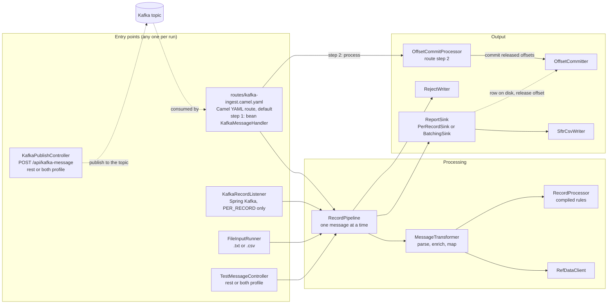
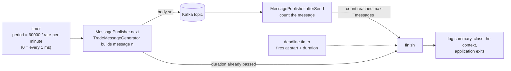

# SFTR Mapping Engine: Design and Architecture

What the system does, how it is put together, and why. For the line-by-line flow see [code-flow-and-classes.md](code-flow-and-classes.md); for the mapping rules see [rules-compilation.md](rules-compilation.md); for pictures see [c4-architecture.md](c4-architecture.md).

## 1. Purpose

Trade systems publish one JSON message per trade. The engine turns each message into one row of an **SFTR transaction report** (a CSV with one column per report field) and writes it to a file for that day. Some columns need data from a **Reference Data Service** (for example the reporting counterparty's LEI), so the engine calls it for each message.

| In | Out |
| --- | --- |
| Messages from a Kafka topic, or from a `.txt` (JSON lines) or `.csv` file | `sftr-report-yyyy-mm-dd.csv`, one row per good message |
| Reference-data answers over HTTP | `sftr-report-yyyy-mm-dd.csv.rejects`, one line per bad message |
| Mapping rules in JSON, constants in YAML | Kafka offsets committed once the row is safely on disk |

For load testing there is also a **publisher mode** that does the opposite: it generates trade messages and sends them to the Kafka topic, at a set rate, for a set count or for a set time (section 4a).

## 2. Design principles

| Principle | What it means in the code |
| --- | --- |
| **Rules are data, not code** | Each column is a JSON rule. Most columns need no Java at all. Logic that cannot be data is a named lambda. |
| **Fail at startup, not on trade one** | Rules are compiled once. Wrong names, missing constants, bad patterns and missing handlers stop the app with every problem listed. |
| **One message at a time, in order** | One consumer, one thread of processing, one lock in the pipeline. Rows appear in the order messages arrived. |
| **A bad message never stops the run** | It goes to the rejects file with a reason and the next message is processed. |
| **No regulatory data in logs or reasons** | Reject reasons and conversion errors never contain message content. `SftrTransactionReport` has no `toString`. |
| **Never commit ahead of the disk** | A Kafka offset is released only after its row (and every row before it) is written. |
| **Same flow for every door** | Kafka, a file and the REST test endpoint all call `RecordPipeline.handle()`. |
| **Column names live in one place** | `OutputColumns` lists every output column name. Mapping lambdas register against those constants, never against string literals, and a test fails if the list and the mapping file differ. |
| **Routes are configuration** | The Kafka consumption route is a YAML file that names a bean and a process. The Java behind it contains no Kafka endpoint code. |

## 3. Architecture at a glance

One Spring Boot application (`sftr-mapping-engine.jar`), no database, no web server unless the test profile is on.

| Layer | Classes | Responsibility |
| --- | --- | --- |
| Entry points | `routes/kafka-ingest.camel.yaml` (calls `KafkaMessageHandler`), `KafkaRecordListener`, `FileInputRunner`, `TestMessageController` | Get a message string and a source reference. Nothing else. |
| Kafka publishing | `KafkaPublishController` | Not an entry point: it puts a message on the topic (`POST /api/kafka-message`), so the consumer handles it like any producer's message. `rest` or `both` profile. |
| Coordination | `RecordPipeline`, `ReportDay` | Take the day once, call the transformer, hand the row to the sink or the reject to the reject writer, run the callback. |
| Transformation | `MessageTransformer`, `RefDataClient`, `RecordProcessor`, `MappingConfigLoader` | Message to row. Rules are compiled by the loader at startup. |
| Output | `ReportSink`, `PerRecordSink`, `BatchingSink`, `SftrCsvWriter`, `RejectWriter`, `OutputFileResolver` | Decide when and where rows and rejects are written. |
| Kafka commit | `OffsetCommitProcessor`, `OffsetCommitter` | Hold released offsets until the consumer thread commits them. |
| Column names | `OutputColumns`, `SftrMappingFunctions` | One constant per output column; lambdas are registered by constant. |
| Publisher | `MessagePublisherRoute`, `MessagePublisher`, `TradeMessageGenerator`, `PublisherProperties` | Generate test messages and send them to Kafka at a rate, for a count or for a time. Only in the `publisher` profile. |
| Configuration | `OutputProperties`, `SftrConstants`, `RefDataClient.Properties` | Typed, validated settings. |

## 4. The two phases

1. **Startup.** Spring creates the beans. `RecordProcessor` asks `MappingConfigLoader` to compile the rules (see [rules-compilation.md](rules-compilation.md)). `OutputProperties` validates the output settings. The sink is chosen from `write-mode`. If anything is wrong, the app stops here.
2. **Running.** Messages flow through `RecordPipeline`. Nothing is re-read or re-compiled.

## 4a. Camel routes and the publisher

Camel is used for the two things that touch Kafka. Both routes are small; the work is in beans.

| Route | Defined in | Does |
| --- | --- | --- |
| `sftr-kafka-ingest` | `src/main/resources/routes/kafka-ingest.camel.yaml` (Camel YAML DSL) | Consumes the topic with one consumer. Step 1 is `bean: kafkaMessageHandler.handle` (message to `RecordPipeline`). Step 2 is `process: offsetCommitProcessor` (commit released offsets). |
| `sftr-publisher` | `MessagePublisherRoute` (Java) | A timer sends one generated message per tick to the topic. Step 1 is `bean: messagePublisher.next`, then `to: kafka:`, then `bean: messagePublisher.afterSend`. |

**How the YAML route is found.** `camel.main.routes-include-pattern: classpath:routes/*.yaml` makes Camel load every YAML file in `routes/` at startup. The topic, brokers, group and offset reset are `{{...}}` placeholders resolved from `application.yml`. The route has `autoStartup: "{{sftr.kafka.enabled}}"`, so it is loaded in every mode but only starts in `kafka` and `both`. The beans it names are always present, so a stopped route never fails the start. If you run with `sftr.ingest=spring-kafka`, also pass `--camel.main.routes-include-pattern=classpath:routes/none`, or both consumers would run.

**Why the publisher route is Java.** The timer period is computed (60000 divided by `rate-per-minute`), and a YAML placeholder cannot do arithmetic. Everything else about it follows the same bean-per-step shape.

**Publisher run.** The `publisher` profile turns Kafka consumption, the REST endpoint and the web server off and keeps the Camel run controller on. Each tick `next` builds message n from the configured lists (`TradeMessageGenerator`), the route sends it, and `afterSend` counts it.

The run ends at the **first** limit reached: `max-messages` (0 = none) or `duration` (0 = none). The deadline timer is a separate daemon thread so a slow rate still ends on time. `finish` runs once, and the exit happens on a new thread because closing the context stops the route that called it. With no limit the publisher runs until it is stopped.

## 5. Key decisions and why

| Decision | Reason | Alternative not taken |
| --- | --- | --- |
| Compile rules to functions at startup | Errors surface at deployment; no per-message parsing or reflection lookup | Interpret the JSON for every message |
| One consumer, one processing thread | Row order must equal arrival order, and the sink owns files | Thread per message or a worker pool (reorders rows, needs a reorder step) |
| Virtual threads **not** used for processing | Work is sequential, so they give no speed-up. Used only for the batch flusher | A virtual thread per message |
| Camel for Kafka ingestion | Requested; small route; `camel-kafka` supports manual commit | Keep Spring Kafka (still available, `PER_RECORD` only) |
| Define the Kafka route in YAML (bean + process) | The wiring is visible and editable without Java; endpoint settings come from `application.yml` | A `RouteBuilder` class (the first version) |
| Route loaded in every mode, started by `autoStartup` | One switch (`sftr.kafka.enabled`) already exists; beans always exist so nothing fails to wire | Load the route only in Kafka profiles (needs a different include pattern per profile) |
| REST endpoint publishes to Kafka (not to the pipeline) | The test then covers the real path, including the consumer, offsets and write modes | Calling `RecordPipeline` directly (that is `/api/test-message`) |
| Publisher route in Java | The timer period is computed from the rate | YAML with a precomputed `period-ms` setting the operator must calculate |
| Output column names as constants | A typo is a compile error, and a test compares the constants with the mapping file | String literals in each lambda registration |
| Commit offsets after the write | With batching, rows wait in memory; committing early would lose them on a crash | Commit on receipt |
| At-least-once delivery | A crash between write and commit re-reads the batch; duplicates were accepted | Exactly-once needs a keyed or idempotent output |
| Commit only on the consumer thread | The Kafka consumer is not thread-safe; committing from another thread throws (proved by a spike) | Commit from the flusher thread |
| Pick the day once per message | The row's date and its file cannot disagree around midnight | Read the clock separately in several places |
| New file when the first row of a day arrives | No helper thread, no empty files | A midnight timer that creates files |
| `Asia/Kolkata` day boundary, configurable | Stated requirement; `file-zone` makes it explicit | Server default zone |
| Failed batch write keeps the rows and retries | Dropping a batch silently would lose data | Log and skip |

## 6. Threads

| Thread | Does | Notes |
| --- | --- | --- |
| Camel Kafka consumer (one) | Polls, runs `RecordPipeline`, commits released offsets | A platform thread. The only thread that may commit. |
| `sftr-batch-flusher` (one virtual thread) | Writes a batch when its deadline passes | Only for `COUNT` and `INTERVAL`. Started on the first buffered row. |
| Web request thread | `POST /api/test-message`, `POST /api/kafka-message` | Only with the `rest` or `both` profile. `RecordPipeline` serialises the first with the consumer; the second only waits for the broker's acknowledgement. |
| Main thread | Runs `FileInputRunner` in file mode | The app exits when it is done. |
| Camel timer thread | Publisher mode: builds and sends each message | One thread, so messages are sent in order. |
| `publisher-deadline` (daemon) | Publisher mode: ends the run when `duration` has passed | Only when `duration` is set. |
| `publisher-exit` | Publisher mode: closes the application after the run | A separate thread, because closing the context stops the timer route. |

One `ReentrantLock` in `RecordPipeline` serialises messages; one in `BatchingSink` guards its buffer and file, so the consumer and flusher never write together.

## 7. Write modes and files

| Mode | Rows reach the CSV | Offsets released |
| --- | --- | --- |
| `PER_RECORD` (default) | Immediately: open, append, close | Immediately |
| `COUNT` | When `batch-size` rows wait | After the batch |
| `INTERVAL` | When the oldest waiting row is `batch-interval` old | After the batch; committed on the next message |

A batch is also written on a **day change**, at **midnight** in `file-zone`, when `max-buffered-records` is reached, and at shutdown or end of file. A batch never mixes two days.

Files are `<name>-yyyy-mm-dd.csv` and `<name>-yyyy-mm-dd.csv.rejects` (`rollover: DAILY`, default). A day's file is created by its first row and gets its own header; a restart on the same day appends.

## 8. Failure handling

| Situation | What happens | Row | Offset |
| --- | --- | --- | --- |
| Empty message, not JSON, not a JSON object | Reject line `Empty message`, `Malformed JSON` or `Not a JSON object` | none | released after earlier rows are durable |
| Reference data 4xx | Reject `Reference data HTTP <code>` (never retried) | none | as above |
| Reference data 5xx or timeout | Retried (`max-attempts`, growing backoff), then reject `Reference data unavailable` | none | as above |
| A rule throws | Reject `Mapping failed for column <name>` | none | as above |
| Output file cannot be written, `PER_RECORD` | Error logged, message skipped | lost | not released by this message; the next message's commit moves past it |
| Batch cannot be written | Error logged, rows kept, retried after 5 seconds | kept in memory | not released until written |
| Buffer full and unwritable | `append` throws, new row refused | not accepted | not released |
| Crash or restart | Messages after the last committed offset are read again | duplicates possible | |
| Wrong rule or setting | App does not start; all problems listed | | |

## 9. Delivery guarantees

- **Order:** rows are written in arrival order for a single partition. With several partitions the order holds within each partition; use one partition for global order.
- **At least once:** a message is never lost once its offset is committed, and an uncommitted message is read again. In `INTERVAL` mode the commit waits for the next message, so the re-read window lasts until then.
- **No de-duplication:** the CSV has no key; a re-read message writes a second row.

## 10. Configuration map

| Area | Where | Main keys |
| --- | --- | --- |
| Which door | `sftr.ingest`, `sftr.kafka.enabled`, `sftr.input.file`, `sftr.rest.enabled` | `camel` (default) or `spring-kafka`; profiles `kafka`, `rest`, `both`, `file`, `publisher` |
| Output | `sftr.output.*` | `file`, `rejects-file`, `write-mode`, `batch-size`, `batch-interval`, `max-buffered-records`, `rollover`, `file-zone`, `file-date` |
| Reference data | `sftr.refdata.*` | `base-url`, `path`, timeouts, `max-attempts`, `backoff`, `request-fields` |
| Rules | `sftr.mapping.config` + `mapper/sftr-field-mappings.json` | one rule per column |
| Kafka route | `routes/kafka-ingest.camel.yaml`, `camel.main.routes-include-pattern` | topic, brokers, group and offset reset from `spring.kafka.*`; starts only when `sftr.kafka.enabled` |
| REST publish to Kafka | `sftr.rest.publish-timeout`, `spring.kafka.producer.*` | wait for the broker (10s); producer `max.block.ms` 5000 so a missing broker fails fast |
| Publisher | `sftr.publisher.*`, profile `publisher` | `rate-per-minute`, `max-messages`, `duration`, `topic`, value lists |
| Constants | `sftr.constants.*` | `values`, `lists`, `lookups` |
| Kafka | `spring.kafka.*`, `sftr.kafka.topic` | brokers, group id, offset reset |

Run modes are profiles: `kafka` (default, Kafka only, no web server), `rest` (test endpoint only, no Kafka), `both` (Kafka and the test endpoint) and `file` (Kafka off; run with `--sftr.input.file=<path>`). Use one of `kafka`, `rest`, `both`. A fifth profile, `publisher`, runs the message publisher instead of the engine (`sftr.publisher.enabled=true`, Kafka consumption off). See [running-locally.md](running-locally.md).

## 11. Extending

| To change | Do |
| --- | --- |
| Add or change a column | A field on `SftrTransactionReport`, a rule in `mapper/sftr-field-mappings.json`, a constant in `OutputColumns`, and a lambda registered with that constant if the rule needs one ([rules-compilation.md](rules-compilation.md), section 10) |
| Add an input source | A component that calls `RecordPipeline.handle(json, sourceRef, whenDurable)` |
| Add a write mode | Implement `ReportSink` and select it in `ReportSinkConfig` |
| Change the reference-data call | `RefDataClient` and `sftr.refdata.request-fields` |

## 12. Known limits

- A single process: no clustering of the output file. Run one instance per output file.
- In `INTERVAL` mode with an idle topic, Kafka offsets stay uncommitted until the next message (duplicates after a restart, accepted).
- Pause and resume of the Kafka route when the output is unwritable is not implemented; the sink refuses new rows instead.
- The Camel route and Spring Boot 4 pairing is verified with Camel 4.23.0.
- The YAML route and the publisher are covered by unit and route tests with no broker; a run against a real broker is by hand (see [running-locally.md](running-locally.md), sections 5 and 5a).
- `POST /api/kafka-message` accepts any topic name and does no parsing; it is a test tool and should not be exposed outside a development machine.
- The publisher sends unkeyed messages with a fixed set of values; it is a load and smoke tool, not a data generator.

History of how the Camel route and write modes were designed: [design-camel-batch-writer.md](design-camel-batch-writer.md) and [c4-camel-batch-writer.md](c4-camel-batch-writer.md).
