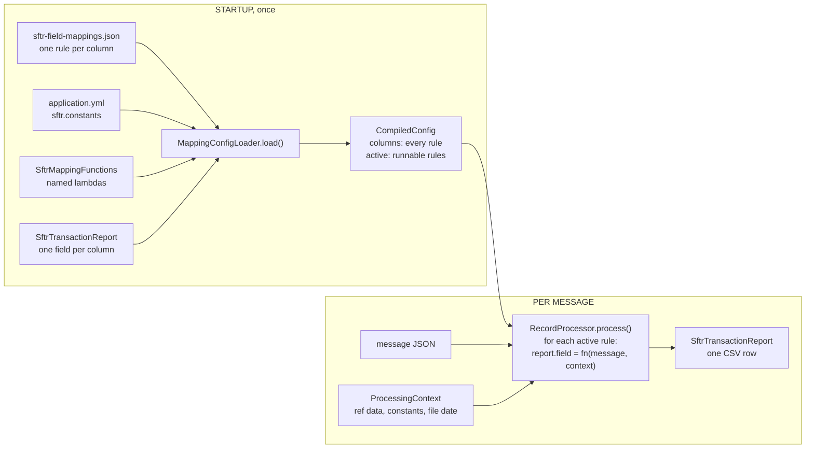
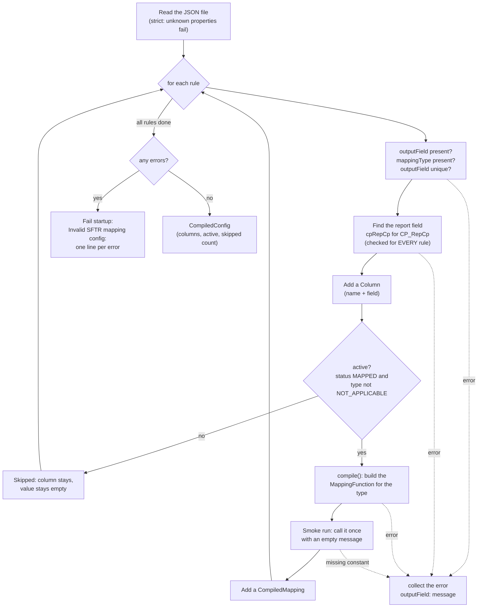
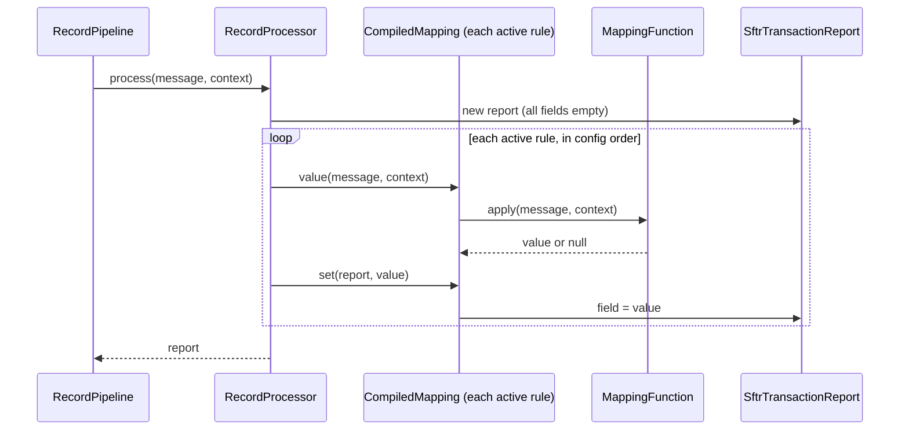

# Mapping Rules: How the Config Becomes Running Code

Every column of the SFTR report is defined by one **rule**: one line in `src/main/resources/sftr-field-mappings.json`. This document explains what a rule is, how the rules are compiled once at startup, what happens to them for every message, and what fails when a rule is wrong.

Related: [code-flow-and-classes.md](code-flow-and-classes.md) (the whole flow), [design-and-architecture.md](design-and-architecture.md) (why it is built this way), [c4-architecture.md](c4-architecture.md) (diagrams).

## 1. The idea in one picture

The JSON is read **once**. Each rule is turned into a small Java function (a `MappingFunction`) and the list of functions is kept in memory. For each message the app just runs that list. The JSON is never read again and no rule is interpreted at message time.



If any rule is wrong, the app **does not start** and prints every problem at once. A mistake in a rule is therefore found at deployment, not on the first trade.

## 2. Anatomy of a rule

A rule is a JSON object. Unknown properties are rejected (a typo such as `inputFeild` stops the start).

| Property | Used by | Meaning |
| --- | --- | --- |
| `outputField` | all | The CSV column name, for example `CP_RepCp`. Required, must be unique, must match a field on `SftrTransactionReport` (section 6). |
| `mappingType` | all | `DIRECT`, `HARDCODE`, `DIRECT_DATA_TRANSFORM`, `TRANSFORM`, `ENRICH` or `NOT_APPLICABLE`. Required. |
| `status` | all | `MAPPED` (default), `PENDING` or `IGNORE`. Only `MAPPED` rules run. |
| `inputField` | `DIRECT`, `DIRECT_DATA_TRANSFORM` | The key to read from the incoming message. |
| `constantRef` | `HARDCODE` | Key under `sftr.constants.values` whose text is the column value. |
| `handler` | `TRANSFORM`, `ENRICH` | Name of the lambda in `SftrMappingFunctions`. Optional: defaults to `outputField`. |
| `formatter` | `DIRECT_DATA_TRANSFORM` | `INTEGER`, `LONG`, `DECIMAL`, `DOUBLE`, `DATE` or `TIMESTAMP`. Required for that type. |
| `inputFormatRef`, `outputFormatRef` | `DIRECT_DATA_TRANSFORM` | Keys under `sftr.constants.values` holding a number or date pattern. Optional. |
| `inputZoneRef`, `outputZoneRef` | `DIRECT_DATA_TRANSFORM` (dates) | Keys under `sftr.constants.values` holding a time zone id. Optional. |
| `description` | none | Free text for people. Not read by the code. |

## 3. Compilation, step by step

`MappingConfigLoader.load()` runs once, when `RecordProcessor` is created at startup.



Key points:

- **Two lists come out.** `columns` has one entry per rule and fixes the CSV header and column order. `active` has one entry per runnable rule. A skipped rule still has its column, so the CSV always has every column.
- **Errors are collected, not thrown one by one.** One bad rule does not hide the others.
- **Skipped rules are checked only lightly.** They must have a valid `outputField`, a `mappingType`, be unique, and name a real report field. Their `inputField`, constants and handlers are *not* checked, so you can park an unfinished rule as `PENDING` without finishing it.
- **The smoke run** calls each compiled function once with an empty message and empty reference data. It exists to catch a function that asks for a constant that does not exist. Any other failure during the smoke run (for example, no data) is ignored on purpose.

### Which rules run

| `status` | `mappingType` | Column in CSV | Runs for each message |
| --- | --- | --- | --- |
| `MAPPED` | any except `NOT_APPLICABLE` | yes | **yes** |
| `MAPPED` | `NOT_APPLICABLE` | yes | no, always empty |
| `PENDING` | any | yes | no, waiting for a decision |
| `IGNORE` | any | yes | no, deliberately not filled |

## 4. The rule types

`compile()` is a `switch` on `mappingType`. Each branch returns a `MappingFunction`: `Object apply(JsonNode message, ProcessingContext ctx)`.

### 4.1 `DIRECT`: copy a field

```json
{ "outputField": "CP_BranchOfOtherCp", "mappingType": "DIRECT", "inputField": "cparty_branch_cd" }
```

Reads `cparty_branch_cd` from the message as text. A missing field or a JSON `null` gives `null` (an empty CSV cell), never an empty string. `inputField` is required.

### 4.2 `HARDCODE`: a fixed value

```json
{ "outputField": "IM_SubmitterID", "mappingType": "HARDCODE", "constantRef": "submitterId" }
```

The text of `sftr.constants.values.submitterId` is looked up **once at startup** and the function returns that same text for every message. A missing constant fails the start.

### 4.3 `DIRECT_DATA_TRANSFORM`: copy and convert a number or a date

The patterns and zones are never written in the rule; the rule names a constant (`...Ref`) and the pattern lives in `application.yml`. All conversion objects are built **once at startup**, so a bad pattern or zone fails the start, not a message.

Blank or missing input gives `null`. A value that cannot be converted throws `value is not a valid <type> number` or `value is not a valid date/time for the configured format`. The message never contains the value, because the data is regulatory.

**Numbers** (`INTEGER`, `LONG`, `DECIMAL`, `DOUBLE`):

| Step | Behaviour |
| --- | --- |
| Parse | With `inputFormatRef`: parsed with that `DecimalFormat` pattern and the whole text must match. Without: `new BigDecimal(text)`. The decimal point is `.` and the grouping separator is `,` whatever the server locale. |
| Output with `outputFormatRef` | The number is formatted to **text** with that pattern, for any of the four types. |
| Output without it | `INTEGER`: exact int (a fractional part fails). `LONG`: exact long. `DECIMAL`: `BigDecimal`. `DOUBLE`: double. |

```json
{ "outputField": "X", "mappingType": "DIRECT_DATA_TRANSFORM", "inputField": "amount",
  "formatter": "DECIMAL", "inputFormatRef": "amountInput", "outputFormatRef": "amountOutput" }
```
```yaml
sftr.constants.values:
  amountInput: "#,##0.00"      # "1,234.50" is read as 1234.5
  amountOutput: "0.0000"       # and written as "1234.5000"
```

**Dates and timestamps** (`DATE`, `TIMESTAMP`):

| Step | Behaviour |
| --- | --- |
| Parse | With `inputFormatRef`: that pattern. Without: `DateHelpers.ISO_FLEXIBLE`, which accepts a date (`2025-12-31`), a local timestamp (`2025-12-31T10:30:00`) or a timestamp with an offset (`...Z`, `...-05:00`). |
| Zone of the input | If the text has an offset, that is used. Otherwise `inputZoneRef`, and if that is missing, **UTC**. A date without time is taken as the start of that day in that zone. |
| Convert zone | If `outputZoneRef` is set, the instant is converted to that zone. |
| Output | With `outputFormatRef`: that pattern. Without: `DATE` writes `yyyy-MM-dd`, `TIMESTAMP` writes an ISO offset date-time such as `2025-12-31T10:30:00Z`. |

```json
{ "outputField": "X", "mappingType": "DIRECT_DATA_TRANSFORM", "inputField": "execTs", "formatter": "TIMESTAMP",
  "inputFormatRef": "tsInput", "outputFormatRef": "tsOutput", "inputZoneRef": "zoneNy", "outputZoneRef": "zoneUtc" }
```
```yaml
  tsInput: dd/MM/yyyy HH:mm:ss          # "16/10/2026 09:30:00" ...
  tsOutput: "yyyy-MM-dd'T'HH:mm:ss'Z'"
  zoneNy: America/New_York              # ... read as New York time
  zoneUtc: UTC                          # ... written as 2026-10-16T13:30:00Z
```

### 4.4 `TRANSFORM` and `ENRICH`: hand-written logic

```json
{ "outputField": "CP_CpSide", "mappingType": "TRANSFORM" }
{ "outputField": "CP_EntResponsibleForRep", "mappingType": "ENRICH", "handler": "CP_RepCp" }
```

The function is looked up by name in `SftrMappingFunctions`: the `handler` if given, otherwise the `outputField`. No lambda with that name fails the start with `no lambda registered as '<name>'`. Several rules may share one handler (as `CP_EntResponsibleForRep` shares `CP_RepCp`). Registering the same name twice fails the start with `Duplicate mapping function`.

The two names mean different things to the reader only: `TRANSFORM` computes from the message, `ENRICH` uses the reference-data response. The code treats them the same.

A lambda sees the message and the `ProcessingContext`:

```java
register("CP_CpSide", (msg, ctx) ->
        ctx.constants().lookup("cpSide", MappingFunction.text(msg, "trade_type")));
```

| Available | What it gives |
| --- | --- |
| `MappingFunction.text(msg, "field")` | Text of a message field, or `null` if missing or JSON null. |
| `ctx.refData()` | The reference-data response (JSON). Use `RefDataExtractors.at(refData, "a.b.c")` or the `partyLei/partyNature/partySector` helpers. |
| `ctx.constants()` | `value(key)`, `list(key)`, `lookup(table, code)`, `startsWithAny(listKey, text)`. |
| `ctx.fileDate()` | The date of the message as `yyyy-MM-dd`. |
| `DateHelpers` | `dateOf`, `dateOnly`, `isAfter`, `isBefore`, `isEqual`, and so on, for date logic. |

Write lambdas to be tolerant: return `null` for missing input rather than throwing.

## 5. Constants

All constants come from `sftr.constants` in `application.yml` (`SftrConstants`):

| Section | Shape | Used for |
| --- | --- | --- |
| `values` | name to text | `HARDCODE`, patterns, zones, reference-data paths. |
| `lists` | name to list of text | For example `londonLegalEntityPrefixes: [LDNBB, LDN-]`. |
| `lookups` | table, result, list of codes | Written as `GIVE: [PO, DP, ...]` (result to codes) and **inverted** at startup into code to result, so `lookup("cpSide", "PO")` gives `GIVE`. A code listed under two different results fails the start. An unknown code gives `null`. |

A missing key throws `Missing constant: sftr.constants.<section>.<key>`. Constants used by a rule's own properties are checked at startup; constants used inside a lambda are checked by the smoke run (the lambda must read its constants before it reads message data, as `RefDataExtractors` does).

## 6. Output name to report field

`outputField` names the CSV column; the value is stored in a field of `SftrTransactionReport` found by `propertyName()`:

| `outputField` | Java field | Rule |
| --- | --- | --- |
| `IM_SubmitterID` | `imSubmitterID` | Text before the first `_` is lower-cased, underscores are removed, the rest keeps its case. |
| `CP_RepCp` | `cpRepCp` | same |
| `CP_CpSide` | `cpCpSide` | same |
| `Foo` (no `_`) | `foo` | The first letter is lower-cased. |

The field is found with reflection **once at startup** and kept, so there is no reflection lookup per message. A name with no matching field fails the start with `no field '<name>' on SftrTransactionReport`. This is checked for every rule, skipped or not.

Values are stored with `CompiledMapping.set()`. If the function's value is not already the field's type (for example an `Integer` for a `String` field), Spring's `ConversionService` converts it.

## 7. Running the rules for each message



- Rules run **in config order**, one after another, on one thread. A rule cannot see another rule's result; they all read the message and the context.
- If a rule throws, the whole message fails with `Mapping failed for column <name>` and the message goes to the rejects file. No half-filled row is written.
- Skipped rules are never called: their fields stay `null` and the CSV cell is empty.

## 8. Worked example: the seed configuration

The shipped configuration has 16 columns: 9 active, 7 skipped.

| Column | Type | Status | Active | What it does |
| --- | --- | --- | --- | --- |
| `IM_SubmitterID` | `HARDCODE` | MAPPED | yes | `submitterId` constant |
| `IM_ParticipantID` | `HARDCODE` | MAPPED | yes | `participantId` constant |
| `IM_RepCpCodeType` | `HARDCODE` | MAPPED | yes | `repCpCodeType` constant (`LEI`) |
| `CP_RepCp` | `ENRICH` | MAPPED | yes | LEI from reference data |
| `CP_NatureOfRepCp` | `ENRICH` | MAPPED | yes | nature from reference data, default `F` |
| `IM_NatureOfOtherCp` | `ENRICH` | PENDING | no | |
| `CP_SecOfRepCp` | `ENRICH` | MAPPED | yes | sector from reference data |
| `CP_AdditionalSecClass` | `NOT_APPLICABLE` | MAPPED | no | always empty |
| `IM_BranchOfRepCpType` | `TRANSFORM` | PENDING | no | |
| `CP_BranchOfRepCp` | `TRANSFORM` | MAPPED | yes | `GB` for London legal entities, else empty |
| `IM_BranchOfOtherCpType` | `TRANSFORM` | IGNORE | no | |
| `CP_BranchOfOtherCp` | `DIRECT` | IGNORE | no | |
| `CP_CpSide` | `TRANSFORM` | MAPPED | yes | `trade_type` to `GIVE` or `TAKE` |
| `CP_EntResponsibleForRep` | `ENRICH` (handler `CP_RepCp`) | MAPPED | yes | same LEI as `CP_RepCp` |
| `IM_OtherCptyEntResponsibleForRep` | `ENRICH` | PENDING | no | |
| `IM_OtherCpType` | `TRANSFORM` | PENDING | no | |

Trace of `{"trade_type":"PO","bmoLegalEntity":"LDNBB01",...}` with a reference-data answer that has LEI `549300ABCDEFGHIJ0001`, nature `C`, sector `CDTI`:

| Column | Result | Why |
| --- | --- | --- |
| `IM_SubmitterID` | `BMOLN9000003` | constant |
| `CP_RepCp` | `549300ABCDEFGHIJ0001` | read at `find_sftr_party.values.lei` |
| `CP_NatureOfRepCp` | `C` | reference data; if blank, the default `F` |
| `CP_SecOfRepCp` | `CDTI` | reference data |
| `CP_BranchOfRepCp` | `GB` | `LDNBB01` starts with a prefix in `londonLegalEntityPrefixes` |
| `CP_CpSide` | `GIVE` | `cpSide` lookup: `PO` is under `GIVE` |
| `CP_EntResponsibleForRep` | `549300ABCDEFGHIJ0001` | handler `CP_RepCp` |
| the other 7 | empty | skipped |

## 9. Startup errors and what they mean

All of these stop the app. Problems from several rules are listed together under `Invalid SFTR mapping config:`, one line per rule as `<outputField>: <message>`.

| Message | Cause | Fix |
| --- | --- | --- |
| `Cannot read SFTR mapping config <file>` | File missing or unreadable | Check `sftr.mapping.config`. |
| `Invalid SFTR mapping config <file>: ...` | Not valid JSON, an unknown property, or a bad enum value | Fix the JSON; check spelling of properties and of `mappingType`, `status`, `formatter`. |
| `outputField is required` / `mappingType is required` | Missing property | Add it. |
| `duplicate outputField` | Two rules for one column | Remove one. |
| `no field '<x>' on SftrTransactionReport` | No matching field (section 6) | Add the field to the class, or fix the name. |
| `inputField is required` | `DIRECT` or `DIRECT_DATA_TRANSFORM` without it | Add it. |
| `constantRef is required` | `HARDCODE` without it | Add it. |
| `formatter is required` | `DIRECT_DATA_TRANSFORM` without it | Add it. |
| `Missing constant: sftr.constants.<section>.<key>` | A `constantRef`, `...FormatRef`, `...ZoneRef`, or a constant read by a lambda is not in `application.yml` | Add the constant. |
| `no lambda registered as '<name>'` | `TRANSFORM` or `ENRICH` with no matching lambda | Register it in `SftrMappingFunctions`, or set `handler`. |
| A pattern or zone error from Java | Bad `DecimalFormat` or date pattern, or unknown zone id | Fix the constant. |
| `lookups.<table>: code '<c>' appears under both '<a>' and '<b>'` | One code mapped to two results | Remove one. |
| `Duplicate mapping function: <name>` | Same lambda name registered twice | Rename one. |

## 10. How to add or change a rule

1. **Copy, constant or conversion:** add a line to `sftr-field-mappings.json`. Put any constant, pattern or zone in `application.yml` under `sftr.constants.values`.
2. **Custom logic:** set `TRANSFORM` or `ENRICH`, then add `register("<name>", (msg, ctx) -> ...)` in `SftrMappingFunctions` (keep them grouped by business area).
3. **A brand-new column:** first add a field to `SftrTransactionReport`, named by the rule in section 6, then add the rule. Column order is the order of the rules in the file.
4. **Park a column:** set `status` to `PENDING` or `IGNORE`.
5. **Check:** run `mvn test`. `ConfigConsistencyTest` loads the real config against the real class, and `MappingConfigLoaderTest` expects the seed config to have 9 active and 7 skipped rules, so update that count when you activate or add a rule. Add a test for new lambda logic in `SftrMappingFunctionsTest`.

## 11. Where to look in the code

| Concern | Class |
| --- | --- |
| Reading and compiling the rules | `engine.MappingConfigLoader` |
| Running the compiled rules | `engine.RecordProcessor` |
| One rule as data | `model.FieldMapping` |
| One compiled step | `MappingConfigLoader.CompiledMapping` |
| The function interface | `model.MappingFunction` |
| Hand-written lambdas | `functions.SftrMappingFunctions` |
| Reference-data paths | `functions.RefDataExtractors` |
| Date logic | `functions.DateHelpers` |
| Constants | `model.SftrConstants` |
| The row | `model.SftrTransactionReport` |
